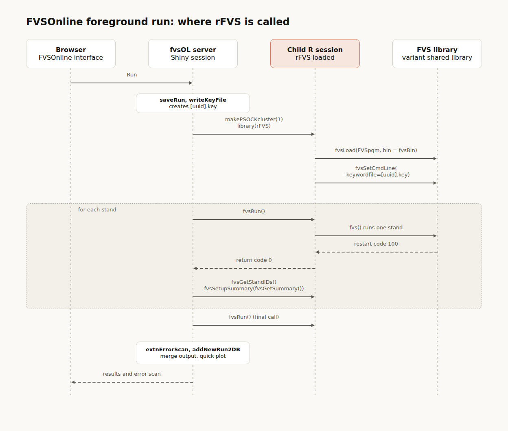

```{r setup, include=FALSE, message=FALSE, warning=FALSE}
knitr::opts_chunk$set(echo = FALSE, message=FALSE, warning = FALSE)

  require(dplyr)
  require(glue)
  require(ggplot2)
  require(flextable)
  require(officer)

#### options ####
options(stringsAsFactors = FALSE, 
        scipen=21,
        dplyr.print_max = 100)
theme_set(theme_bw())


```

```{r tables, echo=FALSE}

# Tables 
rfvs.exec.funcs=dplyr::tribble(
 ~Function, ~Description,
 "fvsLoad", "Loads the desired FVS program as a shared library",
 "fvsMakeKeyFile", "Creates an FVS keyword file for use with fvsSetCmdLine and fvsRun",
 "fvsSetCmdLine", "Sets the command line arguments (keyword file)",
 "fvsRun", "Runs FVS up to a designated stop point, year or both",
 "fvsInteractRun", "Runs FVS where FVS and R interact",
 "fvsUnitConversion", "Gets FVS units conversion factors",
 "fvsGetSpeciesCodes", "Returns a matrix of species codes") %>% 
  flextable() %>% 
  set_caption(caption = 'rFVS execution functions',
              style = 'Table Caption',
              autonum = run_autonum(seq_id = "tab", bkm = "tab1")) %>%
  autofit()


rfvs.restart.pts=dplyr::tribble(
 ~`Stop point code`, ~`fvsStopPoint called from`, ~`FVS resumes at`,
 "7", "FVS", "Just before the stand density and calibration calls (SDICLS, CRATET)",
 "1", "GRINCR", "The first EVMON call (IPHASE=1)",
 "2", "GRINCR", "The economic status call (ECSTATUS) that precedes CUTS, then CUTS",
 "3", "GRINCR", "The second EVMON call (IPHASE=2)",
 "4", "GRINCR", "The economic status call that follows CUTS (ECSTATUS), then the setup for growth estimation",
 "5", "GRADD", "UPDATE",
 "6", "GRADD", "CLAUESTB and ESNUTR (regeneration establishment)") %>% 
  flextable() %>% 
  set_caption(caption = 'Stop point restart locations',
              style = 'Table Caption',
              autonum = run_autonum(seq_id = "tab", bkm = "tab_rfvs_restart_pts")) %>%
  set_table_properties(layout = "autofit", width = 1)


rfvs.layers=dplyr::tribble(
 ~`Layer`, ~`Where`, ~`Role`,
 "R function", "rFVS package", "Checks arguments, calls .C or .Fortran, builds the R object that is returned",
 "C wrapper", "apisubsc.c", "Dereferences the character arguments",
 "C-callable Fortran routine", "apisubs.f, cmdline.f", "Copies characters into a Fortran string",
 "Fortran routine", "apisubs.f", "Selects the array by name and reads or writes it",
 "FVS arrays", "COMMON blocks", "Tree, species, event monitor, summary and SVS data") %>% 
  flextable() %>% 
  set_caption(caption = 'Layers between an rFVS function and FVS',
              style = 'Table Caption',
              autonum = run_autonum(seq_id = "tab", bkm = "tab_rfvs_layers")) %>%
  set_table_properties(layout = "autofit", width = 1)


rfvs.exec.overview=dplyr::tribble(
 ~`Function`, ~`R call and Fortran routine`, ~`Variables and arrays`, ~`R input`, ~`R return`,
 "fvsLoad", "R function: dyn.unload, dyn.load, is.loaded; no FVS routine is run", "global R object .FVSLOADEDLIBRARY", "fvsProgram, bin", "invisible character path of the library",
 "fvsSetCmdLine", ".C CfvsSetCmdLine, fvsSetCmdLineC, fvsSetCmdLine (cmdline.f); FILCLOSE, GENRPT, FILOPN", "keywordfile, restartfile, stopptfile, maxStoppts, fvsRtnCode, restartcode, minorstopptcode, minorstopptyear, majorstopptcode, majorstopptyear, stopstatcd, originalRestartCode, readFilePos, oldstopyr, firstWrite, jstash, jdstash (GLBLCNTL)", "cl (character, at most 255 characters)", "invisible list of the three .C arguments (the FVS return code is the third), or NULL",
 "fvsRun", ".Fortran fvsSetStoppointCodes (cmdline.f); .Fortran fvs (fvs.f); .Fortran fvsGetRestartCode (cmdline.f)", "minorstopptcode, minorstopptyear, restartcode, stopstatcd, fvsRtnCode (GLBLCNTL)", "stopPointCode, stopPointYear (integers, both or neither)", "invisible integer FVS return code",
 "fvsInteractRun", "as fvsRun, with fvsSetStoppointCodes called for each requested stop point; fvsGetStandIDs and fvsGetEventMonitorVariables", "minorstopptcode, minorstopptyear, restartcode, fvsRtnCode (GLBLCNTL)", "named code blocks and trace", "named list of the block results",
 "fvsUnitConversion", ".C CfvsUnitConversion, fvsUnitConversionC, fvsUnitConversion (apisubs.f)", "the 29 constants in METRIC.F77 (listed in the entry)", "name (character, at most 15 characters)", "numeric scalar, or NA",
 "fvsGetSpeciesCodes", ".C CfvsSpeciesCode, fvsSpeciesCodeC, fvsSpeciesCode (apisubs.f), once per species index", "JSP, FIAJSP, PLNJSP", "none", "character matrix (maxspecies x 3)") %>% 
  flextable() %>% 
  set_caption(caption = 'Execution functions: calls, variables and returns',
              style = 'Table Caption',
              autonum = run_autonum(seq_id = "tab", bkm = "tab_rfvs_exec_overview")) %>%
  set_table_properties(layout = "autofit", width = 1)


rfvs.get.funcs=dplyr::tribble(
 ~`Function`, ~`Description`,
 "fvsCompositeSum", "Builds a composite summary statistics table from a list of summary tables",
 "fvsGetDims", "Returns the max dimensions of important FVS data storage",
 "fvsGetEventMonitorVariables", "Gets Event Monitor variables",
 "fvsGetRestartcode", "Gets the current FVS restart code",
 "fvsGetSpeciesAttrs", "Returns the values of species-specific data",
 "fvsGetStandIDs", "Returns stand identification codes",
 "fvsGetSummary", "Returns a dataframe of the summary statistics",
 "fvsGetSVSDims", "Returns the max dimensions of important Stand Visualization System data storage",
 "fvsGetSVSObjectSet", "Returns the Stand Visualization System objects (trees, snags, coarse woody debris)",
 "fvsGetTreeAttrs", "Gets attributes of trees",
 "fvsSetupSummary", "Reorganizes summary statistics so they are ready to plot") %>% 
  flextable() %>% 
  set_caption(caption = 'rFVS functions that get information from FVS',
              style = 'Table Caption',
              autonum = run_autonum(seq_id = "tab", bkm = "tab_rfvs_get_funcs")) %>%
  set_table_properties(layout = "autofit", width = 1)


rfvs.get.overview=dplyr::tribble(
 ~`Function`, ~`R call, C wrapper and Fortran routine`, ~`Arrays and variables read`, ~`R input`, ~`R return`,
 "fvsGetDims", ".Fortran fvsDimSizes", "IREC1 or ITRN, NCYC, IPTINV, MAXTRE, MAXSP, MAXPLT, MAXCYC", "none", "named numeric vector (7)",
 "fvsGetEventMonitorVariables", ".C CfvsEvmonAttr, fvsEvmonAttrC, fvsEvmonAttr (\"get\")", "TSTV1, TSTV2, TSTV3, TSTV4, LTSTV4, FLIVE(1:2), TSTV5, CTSTV5, LTSTV5", "character vector of names", "named numeric vector (NA if undefined or not found)",
 "fvsGetRestartcode", ".Fortran fvsGetRestartCode (cmdline.f)", "restartcode and fvsRtnCode (GLBLCNTL)", "none", "integer",
 "fvsGetSpeciesAttrs", ".C CfvsSpeciesAttr, fvsSpeciesAttrC, fvsSpeciesAttr (\"get\")", "RELDSP, SITEAR, SDIDEF, BFMIND, BFTOPD, BFSTMP, FRMCLS, METHB, DBHMIN, TOPD, STMP, METHC, XDMULT, XHMULT, XMMULT, XMDIA1, XMDIA2, XRDMLT, XRHMLT, SIZCAP(,1), SIZCAP(,2), SIZCAP(,3), SIZCAP(,4)", "character vector of attribute names", "dataframe (rows = species)",
 "fvsGetStandIDs", ".C CfvsStandID, fvsStandIDC", "NPLT, DBCN, MGMID, CASEID", "none", "named list of four character strings",
 "fvsGetSummary", ".Fortran fvsSummary, once per cycle row", "IOSUM(22, MAXCY1) (OUTCOM)", "none", "numeric matrix (20 named columns)",
 "fvsGetSVSDims", ".Fortran fvsSVSDimSizes", "NSVOBJ, NDEAD, NCWD, MXSVOB, MXDEAD, MXCWD", "none", "named numeric vector (6)",
 "fvsGetSVSObjectSet", ".C CfvsSVSObjData, fvsSVSObjDataC, fvsSVSObjData; .C CfvsFFEAttrs, fvsFFEAttrsC, fvsFFEAttrs; also fvsGetTreeAttrs and fvsGetSpeciesCodes", "IOBJTP, IS2F, XSLOC, YSLOC, SNGDIA, SNGLEN, IYRCOD, ISNSP, FALLDIR, ISTATUS, SNGCNWT(,0), SNGCNWT(,1), SNGCNWT(,2), SNGCNWT(,3), CWDDIA, CWDLEN, CWDPIL, CWDDIR, CWDWT, TFALL(1:MAXSP,0), TFALL(1:MAXSP,1), TFALL(1:MAXSP,2), TFALL(1:MAXSP,3)", "none", "list of three dataframes (trees, snags, cwd)",
 "fvsGetTreeAttrs", ".C CfvsTreeAttr, fvsTreeAttrC, fvsTreeAttr (\"get\")", "PROB, WK2, DBH, DG, HT, HTG, CRWDTH, ICR, ISP, ABIRTH, ITRE, CFV, MCFV, SCFV, BFV, DEFECT, PTBALT, IMC, PLTSIZ, PCT, CROWNW(,0), CROWNW(,1), CROWNW(,2), CROWNW(,3), CROWNW(,4), CROWNW(,5), IDTREE, ISPECL, KUTKOD, WK6", "character vector of attribute names", "dataframe (rows = tree records)") %>% 
  flextable() %>% 
  set_caption(caption = 'Get functions: calls, arrays and returns',
              style = 'Table Caption',
              autonum = run_autonum(seq_id = "tab", bkm = "tab_rfvs_get_overview")) %>%
  set_table_properties(layout = "autofit", width = 1)


rfvs.set.funcs=dplyr::tribble(
 ~`Function`, ~`Description`,
 "fvsAddActivity", "Adds an FVS Activity to the activity schedule",
 "fvsAddTrees", "Adds new tree records to the simulation",
 "fvsCutNow", "Specifies a thinning by setting the proportion of each tree record to cut",
 "fvsSetEventMonitorVariables", "Sets Event Monitor variables",
 "fvsSetSpeciesAttrs", "Sets the values of species-specific data",
 "fvsSetTreeAttrs", "Sets attributes of trees") %>% 
  flextable() %>% 
  set_caption(caption = 'rFVS functions that send information to FVS',
              style = 'Table Caption',
              autonum = run_autonum(seq_id = "tab", bkm = "tab_rfvs_set_funcs")) %>%
  set_table_properties(layout = "autofit", width = 1)


rfvs.set.overview=dplyr::tribble(
 ~`Function`, ~`R call, C wrapper and Fortran routine`, ~`Arrays and variables written`, ~`R input`, ~`R return`,
 "fvsAddActivity", ".Fortran fvsAddActivity, then OPADD, OPNEW and OPINCR", "OPCOM activity arrays: IACT(,1:5), IDATE, ISEQ, IOPSRT, PARMS; pointers IMPL and IMGL", "year (integer), activity (code or name), parms (numeric, at most 20 values)", "invisible 0 or 1; with no arguments, a named vector of activity codes",
 "fvsAddTrees", ".Fortran fvsAddTrees", "DBH, ISP, HT, ICR, ITRE, PROB, IMC, ABIRTH, IDTREE, CRWDTH (CWCALC); set to zero: CFV, MCFV, SCFV, BFV, DG, HTG, PCT, OLDPCT, WK1, WK2, WK4, CULL, PTBALT, DEFECT, ISPECL, ITRUNC, NORMHT, DECAYCD, WDLDSTEM, ABVGRD_BIO, MERCH_BIO, CUBSAW_BIO, FOLI_BIO, ABVGRD_CARB, MERCH_CARB, CUBSAW_CARB, FOLI_CARB, CARB_FRAC, IESTAT, OLDRN, PTOCFV, PMRCFV, PMRBFV, NCFDEF, NBFDEF, PDBH, PHT; ZRAND set to -999; counters ITRN, IREC1, IFST; routines MISPUTZ, SPESRT, RDPSRT", "dataframe with dbh, species, ht, cratio, plot, tpa (sent as six double vectors and a count)", "invisible 0 or 1",
 "fvsCutNow", "R function: fvsAddActivity(\"base_thinprsc\", c(1, -1)) and fvsSetTreeAttrs", "OPCOM activity arrays (as fvsAddActivity), WK6", "numeric vector of proportions (length 1 or one per tree record)", "return code (0 or nonzero)",
 "fvsSetEventMonitorVariables", ".C CfvsEvmonAttr, fvsEvmonAttrC, fvsEvmonAttr (\"set\")", "TSTV1, TSTV2, TSTV3, TSTV4, LTSTV4, FLIVE(1:2), TSTV5, CTSTV5, LTSTV5, ITST5", "named numeric vector", "named numeric vector (NA where not set)",
 "fvsSetSpeciesAttrs", ".C CfvsSpeciesAttr, fvsSpeciesAttrC, fvsSpeciesAttr (\"set\")", "RELDSP, SITEAR, SDIDEF, BFMIND, BFTOPD, BFSTMP, FRMCLS, METHB (int), DBHMIN, TOPD, STMP, METHC (int), XDMULT, XHMULT, XMMULT, XMDIA1, XMDIA2, XRDMLT, XRHMLT, SIZCAP(,1), SIZCAP(,2), SIZCAP(,3), SIZCAP(,4)", "named list of numeric vectors, each of length maxspecies", "invisible integer (largest return code)",
 "fvsSetTreeAttrs", ".C CfvsTreeAttr, fvsTreeAttrC, fvsTreeAttr (\"set\")", "PROB, WK2, DBH, DG, HT, HTG, CRWDTH, ICR (int), ISP (int), ABIRTH, ITRE (int), CFV, MCFV, SCFV, BFV, DEFECT (int), PTBALT, IMC (int), PLTSIZ (int), PCT (int), CROWNW(,0), CROWNW(,1), CROWNW(,2), CROWNW(,3), CROWNW(,4), CROWNW(,5), IDTREE (int), ISPECL (int), KUTKOD (int), WK6", "named list or dataframe of numeric vectors, each of length ntrees", "invisible integer (largest return code)") %>% 
  flextable() %>% 
  set_caption(caption = 'Set functions: calls, arrays and returns',
              style = 'Table Caption',
              autonum = run_autonum(seq_id = "tab", bkm = "tab_rfvs_set_overview")) %>%
  set_table_properties(layout = "autofit", width = 1)


fvsol.roles=dplyr::tribble(
 ~`Part`, ~`Responsibility`,
 "fvsOL", "Collects the run definition, writes the keyword file, starts R child sessions, scans the output for errors and merges the output into the project output database (FVSOut.db)",
 "rFVS", "Loads the FVS library, passes the keyword file name to FVS, runs each stand and reads or modifies the FVS data when a custom run script is used",
 "FVS library", "Reads the keyword file and the input database, projects each stand and writes the output (the FVS output file and the run's output database)") %>% 
  flextable() %>% 
  set_caption(caption = 'Division of work in FVSOnline',
              style = 'Table Caption',
              autonum = run_autonum(seq_id = "tab", bkm = "tab_fvsol_roles")) %>%
  set_table_properties(layout = "autofit", width = 1)


fvsol.fg.funcs=dplyr::tribble(
 ~`Step`, ~`rFVS function`, ~`Purpose`,
 "3", "fvsLoad", "Loads the selected FVS library",
 "3", "fvsSetCmdLine", "Gives FVS the keyword file name",
 "4", "fvsRun", "Runs one stand to its end",
 "4", "fvsGetStandIDs", "Identifies the stand and the management ID that was just run",
 "4", "fvsGetSummary, fvsSetupSummary", "Reads the summary table of the stand and formats it for the quick plot") %>% 
  flextable() %>% 
  set_caption(caption = 'rFVS functions called in an FVSOnline foreground run',
              style = 'Table Caption',
              autonum = run_autonum(seq_id = "tab", bkm = "tab_fvsol_fg_funcs")) %>%
  set_table_properties(layout = "autofit", width = 1)


fvsol.custom=dplyr::tribble(
 ~`Script`, ~`Stop point codes used`, ~`Uses`,
 "Acadian", "7, 1, 5 and 6", "Heights and crown ratios (stop points 7 and 1); tree records each cycle (stop point 5); new tree records and volumes (stop point 6)",
 "Adirondack", "5 and 6", "Tree records each cycle (stop point 5); new tree records (stop point 6)",
 "Hi", "7, 1 and 5", "Heights and crown ratios (stop points 7 and 1); tree records each cycle (stop point 5)") %>% 
  flextable() %>% 
  set_caption(caption = 'Stop points used by the custom run scripts',
              style = 'Table Caption',
              autonum = run_autonum(seq_id = "tab", bkm = "tab_fvsol_custom")) %>%
  set_table_properties(layout = "autofit", width = 1)


```


## Introduction

rFVS is a package of R-language functions that provides interaction between the Forest Vegetation Simulator (FVS) and R. The system enables FVS to run as a dynamic load library (.dll on Windows, .dylib on MacOS, .so on Unix-like systems) inside an R session. This allows for execution of FVS projections and real-time access to and modification of FVS predictions during simulation runs.

rFVS serves as a bridge between FVS's forest growth and yield simulation capabilities and R's statistical computing environment. The system is part of the ForestVegetationSimulator-Interface GitHub repository, which provides R and Shiny interfaces for the USFS Forest Vegetation Simulator. The primary purposes include:

- **Model integration**: Incorporating external R-based growth and yield models into FVS simulations
- **Custom analytics**: Leveraging R's statistical and program integration capabilities within FVS workflows
- **Research and development**: Enabling experimental modifications to FVS behavior for research and development purposes
- **FVSOnline interface support**: Providing the underlying R functionality for FVSOnline, the Shiny-based FVS interface

Following is a brief overview of rFVS and examples of use cases. This document assumes familiarity with R, growth and yield modeling concepts and FVS operations. For additional information about FVS, refer to [Essential FVS](https://www.fs.usda.gov/sites/default/files/forest-management/essential-fvs.pdf) (Dixon 2002).

## History

rFVS was developed as part of the broader FVS Application Program Interface (API) initiative to enable interaction between FVS and external programming languages (USDA Forest Service 2025a). The most notable early application of rFVS was the integration of the Acadian growth model, FVS-ACD, which integrates the Acadian growth, ingrowth and mortality calculations with the FVS Northeast variant (FVS-NE). 

The rFVS system is currently housed in a GitHub repository maintained by the USDA Forest Service (USDA Forest Service 2025a). This integration approach has since been adopted for other regional models and custom applications. The official rFVS package is distributed through the Forest Vegetation Simulator-Interface repository and is built using standard R package development tools including devtools for documentation, building and installation processes.

## Use cases and applications

### Regional model integration
The rFVS framework allows using FVS integration with regional growth and/or mortality equations rather than creating a standalone growth and yield framework. This allows growth projections that selectively substitute regional growth model calculations for FVS calculations. This approach also retains the full suite of FVS management simulation capabilities. For the most part the user interaction with the model is little changed when using this approach, significantly reducing the burden on users. 

This approach has been successfully used to integrate the Acadian model (FVS-ACD), the Adirondack model (FVS-ADK) and the koa growth model for Hawaii (FVS-HI).

### Research and development applications
Using the rFVS framework researchers can test new equations and tools without the burden of creating a purpose-built model. rFVS could be useful in cases such as:

- Testing experimental growth or mortality equations
- Developing novel modifiers, such as forest health or post-harvest modifiers
- Developing regeneration algorithms
- Prototyping new volume estimation methods

### FVSOnline integration
Since the retirement of the FVS Suppose interface, FVSOnline has been the primary way for users to interact with FVS via a graphic user interface. Users interact with FVS via the R Shiny application and the underlying code utilizes user selections to build keyword files; execute FVS and provide tables and figures of the results. Additional details are provided below in the [FVSOnline graphic interface](#fvsonline-graphic-interface) section. 


## FVS processing flow

FVS processes a stand in three sequential phases: the projection initialization phase, the projection cycling phase and the projection summarization phase. The initialization phase prepares the stand for simulation; the cycling phase projects the stand through time; and the summarization phase produces output reports. FVS can process a single stand or many stands in one run. In a serial run each stand is processed to completion before the next stand begins. 

### Input data and the activity schedule

FVS requires three types of input: parameter and user control data communicated via keyword records, stand-level data and individual tree inventory data. Stand and tree data can come from a database or from external files; the keyword record file is always required and controls basic input even when a database is used.

Management activities are scheduled by year, projection cycle or by condition using IF-THEN-ENDIF keyword sequences. Internally FVS maintains an activity schedule table where each row represents a scheduled activity and columns hold associated parameters including the scheduled year. As keyword records are processed during initialization, activities are posted to this table. During cycling, conditions are evaluated each cycle and any condition-based activities that are satisfied are posted. Each cycle the table is consulted and due activities are executed. Activities are tagged as DONE, NOT DONE or CANCELLED depending on their disposition. The fvsAddActivity function adds activities to this table from R at a stop point.

### Tree data storage and access

Individual tree record data is stored in arrays within the ARRAYS labeled COMMON block and updated as the projection progresses. Tree records are stored in input order, not sorted order. The number of tree records currently in the simulation is carried in the variable ITRN in the CONTRL labeled COMMON block. Each tree record has an internal sequence number from 1 to ITRN that serves as the storage index into all tree arrays. For example, the diameter for the tree at position 5 is in DBH(5), its height in HT(5) and its expansion factor in PROB(5).

PROB(*i*) — the number of trees per acre that tree record *i* represents — is the key per-tree scalar used throughout the model. Mortality reduces PROB(*i*); harvesting also reduces it. Stand-level statistics are computed by summing across all ITRN tree records weighted by PROB(*i*). In rFVS this variable is exposed as the `tpa` tree attribute.

Three arrays support access patterns beyond simple 1-to-ITRN loops:

- **IND(*i*)**: integer pointers to tree data array locations, sorted in descending diameter order. IND(1) points to the record of the largest diameter tree.
- **IND1(*k*)**: partitioned into contiguous species sectors where each sector contains the internal sequence numbers for all records of one species.
- **ISCT(*i*,*j*)**: companion to IND1; ISCT(*i*,1) and ISCT(*i*,2) give the first and last positions within IND1 for species *i*. If no records exist for species *i*, both values are zero. This structure allows growth loops to retrieve species-specific coefficients once and then iterate only over records of that species.

### The main FVS subroutine

The top-level routine PROGRAM MAIN calls fvsSetCmdLine to retrieve command line options (keyword file name, restart file name, stop point parameters) and then calls subroutine FVS, which orchestrates all other subroutines. PROGRAM MAIN contains the only FORTRAN STOP statement in the program. This structure, separating MAIN from subroutine FVS, was introduced around 2010 specifically to support use of FVS as a shared library callable by external programs such as rFVS.

During the projection initialization phase, subroutine FVS: checks command line options and return/restart codes; opens required input and output files; initializes parameters to defaults; processes all keyword records; sets up the projection cycling array; initializes extension files; establishes the initial species sort; expands tree data to a per-acre basis based on the sample design; calibrates internal equations to the input data; flags best trees for the regeneration establishment model; computes initial tree-level variables (volumes, crown width); computes initial stand-level variables (basal area per acre); computes initial percentile distributions; assigns example trees to output arrays; and writes initial output data. A logical variable LSTART is set to .TRUE. during initialization and .FALSE. upon completion; it is used extensively during model calibration to control program logic flow.

During the projection cycling phase, subroutine FVS calls subroutines to estimate tree growth and mortality, process management requests, establish regeneration and write output. During the summarization phase it produces final reports. FVS then returns to its caller (PROGRAM MAIN, or rFVS) after each stand and is called again for the next stand.


## Start-stop logic

FVS can run from beginning to end without stopping, or stop at specified points (USDAForestService 2025b). rFVS uses the FVS stop-restart capability, which allows simulations to be paused at specific computational points and resumed with full state preservation (USDAForestService 2025c). This functionality enables real-time interaction between R and FVS during simulation execution.

When running as a shared library (the rFVS case), all essential projection state is maintained in COMMON block memory within the loaded library. FVS returns up the call stack to R without writing anything to disk, and the caller is free to use the FVS API to read or modify variables before calling FVS to continue. 


*Figure 1: FVS processing sequence showing available stop points for rFVS interaction*


### Stop point codes and processing sequence

FVS can be instructed to stop at specific computational stages within the processing cycle. Stop points are checked by subroutine fvsStopPoint, which is called from within the subroutines that own each stage. When a stop point is reached, FVS returns up the call stack to R with all COMMON block state intact. Stop points 1 through 6 are checked in every projection cycle, and stop point 7 once per stand during initialization. If a stop point year greater than 0 was requested, the stop occurs only in the cycle that contains that year (see [Stop point years](#stop-point-years)). The following describes each stop point, where in the call sequence it falls, what data is and is not yet computed and which rFVS Get/Set functions are meaningful. The stop point descriptions use the Acadian variant to provide examples, as this is the most mature usage of FVS stop points. 

**Stop point code 0: Never stop**

FVS does not stop at any stop point. fvsRun runs to the end of the current stand and returns with restart code 100. Return code 2 is returned by a later fvsRun call, after the last stand.

**Stop point code -1: Stop at every stop location**

FVS stops at every defined stop point (1 through 7) it encounters in the processing sequence, in every cycle.

**Stop point code 7: After input read, before missing value imputation**

*Invoked from:* subroutine FVS, after subroutine NOTRE has loaded the tree records (and after the pest model initialization that follows it: RDMN1, MPSDLP and DFBINV) and before subroutine CRATET is called. This stop point occurs once per stand, with the cycle counter set to 1. When FVS resumes, it continues just before CRATET, so values set here are in place when imputation and calibration run.

Raw tree data as read from the input file or database is available. DBH(*i*), HT(*i*), ICR(*i*), PROB(*i*) and ISP(*i*) are populated for all ITRN tree records, but heights and crown ratios that were absent in the input are still missing (coded as 0 or flag values). Growth increments DG and HTG are not yet defined. Volumes CFV, MCFV, BFV are zero. Stand-level variables (basal area, CCF, SDI) have not yet been computed. The ARRAYS COMMON block is partially populated.

Dubbed heights and crown ratios, calibrated growth multipliers, percentile arrays PCT and PTBALT, stand density metrics and volumes are not yet available. Setting volumes, growth increments or percentile-dependent attributes at this point has no effect as they are overwritten by subsequent initialization.

The Acadian variant integration uses stop point 7 to identify trees requiring height and crown ratio imputation, fetching those records before FVS attempts its own dubbing, then supplying R-computed values at stop point 1. This is the only stop point that occurs during the projection initialization phase.


**Stop point code 1: Before first event monitor call (before-thinning phase)**

*Invoked from:* subroutine GRINCR, before subroutine EVMON is called with IPHASE=1. In every cycle GRINCR first applies the SETSITE activities (site index and SDI maximum changes), sets up the extension models and computes stand density index (SDICAL, SDICLS), forest type (SILFTY) and structural stage (SSTAGE) before it reaches this stop point. In cycle 1 the stop point also follows the model calibration done by subroutine CRATET during initialization.

Full initialization is complete. All tree attributes are defined including dubbed heights, crown ratios calibrated to input data and volume estimates (CFV, MCFV, BFV) computed by subroutine VOLS. Stand density variables including basal area per acre, crown competition factor (CCF) and SDI are current. Percentile arrays PCT(*i*) and PTBALT(*i*) are populated. The IND, IND1 and ISCT sort arrays are established. Before-thinning event monitor variables in groups 1, 3 and 4 (TSTV1, TSTV3 and TSTV4) have not yet been loaded for this cycle — that occurs inside EVMON.

In cycle 1 the before-thinning variables (TSTV1) have not been loaded; in later cycles they hold the previous cycle's values. Growth increments DG and HTG contain zero or prior-cycle values, as they have not been estimated for the current cycle. Mortality (WK2) is not yet computed.

This stop point can be used to supply imputed heights and crown ratios to replace FVS dubbing (as in Acadian), inspect the calibrated tree list, set species-level multipliers before growth begins and add or modify activities with fvsAddActivity before the event monitor evaluates conditions. Note that at stop point 1 the initial tree list has already been written to the database. Heights and crown ratios imputed outside of FVS are therefore used in subsequent FVS calculations, but those values do not appear in the output database.

*rFVS Get calls:* fvsGetTreeAttrs (all attributes). fvsGetSpeciesAttrs. fvsGetDims. fvsGetStandIDs. fvsGetEventMonitorVariables returns before-thinning variables only if cycle ≥ 2 (populated from previous cycle); values are not yet refreshed for the current cycle at this point.

*rFVS Set calls:* fvsSetTreeAttrs (ht, cratio, tpa, dbh, age, mgmtcd). fvsSetSpeciesAttrs (growth multipliers, SDI maxima, site indices; values set here are applied after this cycle's SETSITE processing). fvsSetEventMonitorVariables (user-defined TSTV5 variables). fvsAddActivity.

**Stop point code 2: After first event monitor call, before thinning**

*Invoked from:* subroutine GRINCR, after EVMON returns from the before-thinning phase (IPHASE=1) and before subroutine CUTS is called.

At this stop point before-thinning event monitor variables in groups 1, 3, 4 and 5 (TSTV1, TSTV3, TSTV4 and TSTV5) are now loaded and evaluated. Condition-based activities triggered by the before-thinning event monitor have been posted to the activity schedule. The tree list still reflects the beginning-of-cycle composition; no thinning has occurred. Growth increments and mortality not yet computed. After-thinning stand density statistics not yet updated.

This stop point can be used for inspecting or overriding event monitor variable values before thinning executes; conditionally adding or canceling activities based on external logic before CUTS runs.

*rFVS Get calls:* fvsGetTreeAttrs (all attributes). fvsGetEventMonitorVariables (before-thinning TSTV1 variables: year, atpa, aba, sdi, ccf, structural stage variables, user-defined).

*rFVS Set calls:* fvsSetEventMonitorVariables (TSTV5 user-defined variables). fvsSetTreeAttrs. fvsAddActivity (activities posted here are visible to CUTS for this cycle).

**Stop point code 3: Before second event monitor call (after-thinning phase)**

*Invoked from:* subroutine GRINCR, after subroutine CUTS and the post-thinning density update complete, and before EVMON is called with IPHASE=2.

At this stop point thinning has been applied. PROB(*i*) values are reduced for cut trees; records thinned to zero have been deleted by TREDEL and the IND, IND1, ISCT arrays rebuilt by SPESRT and RDPSRT. When trees were removed, DENSE has recomputed the stand density statistics (basal area and CCF). In every case the post-thinning stand density index (SDICAL and SDICLS), forest type (SILFTY) and structural stage (SSTAGE) have been computed. Removed volume tallies and cut tree lists are finalized. The event monitor has not yet loaded the after-thinning variables (TSTV2). Growth increments and mortality have not yet been computed.

Stop point 3 is useful for inspecting the post-harvest tree list before the after-thinning event monitor evaluates conditions; applying custom post-harvest adjustments to PROB or other tree attributes before growth estimation.

*rFVS Get calls:* fvsGetTreeAttrs (id, species, tpa, dbh, ht, cratio, crwdth, volumes, plot, plotsize, mgmtcd); tpa reflects the post-harvest expansion factors. fvsGetDims (ntrees reflects post-harvest count). fvsGetEventMonitorVariables (before-thinning TSTV1 variables remain available; TSTV2 not yet loaded).

*rFVS Set calls:* fvsSetTreeAttrs (tpa, dbh, ht, cratio, mgmtcd). fvsSetEventMonitorVariables (TSTV5). fvsAddActivity.

**Stop point code 4: After second event monitor call, before growth estimation**

*Invoked from:* subroutine GRINCR, after EVMON returns from the after-thinning phase (IPHASE=2) and before subroutine DGDRIV is called to begin large-tree diameter growth estimation.

At this stop point after-thinning event monitor variables in groups 2 and 5 (TSTV2 and TSTV5) are now loaded and evaluated. Any condition-based activities triggered by the after-thinning event monitor have been posted. Tree list and stand density reflect post-harvest conditions. Growth increments (DG, HTG) not yet estimated for the current cycle. Mortality (WK2) not yet computed. WK2 currently holds values from the previous cycle or zero.

Stop point 4 is the final opportunity to adjust species-level growth multipliers or tree attributes before diameter and height growth estimation begins. Useful for injecting climate-based or disturbance-based growth modifiers that should apply to the current cycle's growth calculation.

*rFVS Get calls:* fvsGetTreeAttrs (all attributes; dg and htg reflect prior-cycle or zero values). fvsGetEventMonitorVariables (TSTV1 and TSTV2 variables). fvsGetSpeciesAttrs.

*rFVS Set calls:* fvsSetSpeciesAttrs (baimult, htgmult, mortmult, regdmult, reghmult — these multipliers are applied inside DGDRIV, HTGF, REGENT and MORTS which have not yet run). fvsSetTreeAttrs (dbh, ht, cratio, tpa before growth runs). fvsSetEventMonitorVariables.

**Stop point code 5: After growth and mortality computation, before application**

*Invoked from:* subroutine GRADD, after subroutine GRINCR returns (growth and mortality estimation complete, record tripling and fertilizer adjustments applied) and before subroutine UPDATE is called to apply increments to the tree arrays. Before this stop point GRADD has already applied the insect, fire and disease adjustments (MPBCUP, DFBDRV, MISTOE, TMCOUP, BWECUP, FMMAIN/FMKILL, BRTREG, RDTREG), HTGSTP and SVMORT, so values set here are applied after those models.

At this stop point DG(*i*) holds the cycle-length diameter growth estimate for each tree record. HTG(*i*) holds the cycle-length height growth estimate. WK2(*i*) holds trees per acre predicted to die (mortality) for each tree record. DBH(*i*) and HT(*i*) still reflect beginning-of-cycle values; UPDATE has not yet been called. UPDATE adds HTG to HT, subtracts WK2 from PROB (never more than the record's PROB) and adds DG divided by the bark ratio to DBH. Volumes (CFV, MCFV, BFV) reflect beginning-of-cycle conditions. If record tripling has occurred, ITRN is expanded and the additional triple records are present in the tree arrays. Crown ratio change has not yet been computed. Regeneration has not been added.

This is the primary stop point for replacing or modifying FVS growth and mortality estimates before they are committed to the tree arrays. The Acadian integration uses this stop point to fetch DG, HTG and WK2, replace them with Acadian-computed values and push them back before resuming. Setting dg=0, htg=0 and mort=0 suppresses all FVS-computed growth and mortality for the cycle.

*rFVS Get calls:* fvsGetTreeAttrs (id, species, tpa, dbh, ht, cratio, dg, htg, mort, age, plot, ptbalt, bapctile — all meaningful here; volumes reflect start of cycle values). fvsGetDims (ntrees includes tripled records if tripling is active). fvsGetEventMonitorVariables.

*rFVS Set calls:* fvsSetTreeAttrs (mort/WK2, dg/DG, htg/HTG are the primary targets; setting dbh or ht here modifies the starting value that UPDATE will then increment (ht by htg, and dbh by dg divided by the bark ratio)). fvsSetEventMonitorVariables.

**Stop point code 6: Before regeneration establishment (ESTAB)**

*Invoked from:* subroutine GRADD, after subroutine UPDATE has applied growth and mortality increments and recomputed stand statistics, and before subroutine ESNUTR calls ESTAB to run the regeneration establishment model.

At this stop point DBH(*i*) and HT(*i*) reflect end of cycle values with growth applied, and PROB(*i*) has been reduced by mortality. Volumes (CFV, MCFV, BFV) are recomputed by UPDATE via VOLS, which is called after HT and PROB are updated and before DBH is advanced by DG. Tree ages (age, stored in ABIRTH) have already been increased by the cycle length, so age is an end of cycle value here; at stop points 1 through 5 it has not yet been increased for the current cycle. The tree records have been re-sorted by diameter (RDPSRT) and the stand density statistics (basal area, CCF, PCT) recomputed by DENSE. The insect, fire and disease adjustments were applied before stop point 5 (see stop point 5). Not yet done: regeneration (CLAUESTB, then ESNUTR, which runs ESTAB and appends the new regeneration records to the tree list), crown ratio change (CROWN) and the update of crown widths. After ESTAB, GRADD updates the SVS visualization, calculates economic values (ECCALC) and recomputes stand density (DENSE) before CROWN.

Stop point 6 is useful for adding ingrowth tree records via fvsAddTrees before ESTAB runs; modifying post-growth tree attributes or volumes; inspecting end of cycle stand conditions before regeneration is added. The Acadian integration uses this stop point to add ingrowth records and optionally override volume estimates.

*rFVS Get calls:* fvsGetTreeAttrs (all attributes; dbh, ht and tpa reflect end of cycle values; volumes are the values computed in UPDATE). fvsGetDims. fvsGetSummary (rows up to the start of the current cycle; the end of cycle row is written after the cycle completes). fvsGetEventMonitorVariables.

*rFVS Set calls:* fvsAddTrees (add ingrowth records before ESTAB runs). fvsSetTreeAttrs (volumes via tcuft/mcuft/bdft can be overridden here; tpa, dbh, ht). fvsSetEventMonitorVariables.

**End of stand (restart code 100)**

After the last cycle of a stand, FVS calls fvsStopPoint with the internal location code -1. This stop is always taken, whatever stop point was requested, and it sets the restart code to 100. FVS first completes the stand's final output (DISPLY and GENPRT) and then returns to R; the next call to fvsRun continues with the next stand. fvsGetRestartcode returns 100 at this point, and this is the stop used by the SimEnd block of fvsInteractRun.

### Stop point years

The stop point year (`stopPointYear` in `fvsRun`) controls in which projection cycles the requested stop point is used. It is given together with the stop point code; the code alone decides whether FVS stops (code 0 never stops).

- **Year greater than 0**: stop only in the cycle that contains that year, that is, the cycle that starts on or before the year and ends after it
- **-1 (or any value below 0)**: no year limit; stop at the requested stop point in every cycle


### Memory state management

When FVS stops and returns control to R, the entire FVS memory state is preserved in COMMON blocks, allowing seamless continuation from the exact stopping point. This enables modification of tree attributes, stand conditions or other FVS variables before resuming simulation. Any variable whose value must survive across a stop/restart boundary must reside in a COMMON block; local subroutine variables are not preserved.

Stop/restart control variables are stored in the labeled COMMON block GLBLCNTL. The key internal subroutines governing stop/restart flow are:

- **fvsStopPoint**: Called from within FVS (e.g., subroutine GRADD) with a location code corresponding to the current stop point. Compares that code against the requested stop point and returns a flag indicating whether stopping was requested. After a stop point returns, the calling subroutine also tests the FVS return code (fvsGetRtnCode) and returns up the call stack if it is not 0.
- **fvsGetRestartCode**: Called at the beginning of subroutines that contain stop points (GRINCR, TREGRO, GRADD) to retrieve the prior stop point code, allowing the subroutine to jump ahead to where it previously left off rather than re-executing already-completed calculations. It returns 0 whenever the FVS return code is not 0.
- **getAmStopping**: An entry point within CMDLINE called by a subroutine (e.g., TREGRO) after a called subroutine (e.g., GRINCR) returns, to determine whether that return was caused by a stop point rather than normal completion.
- **fvsGetRtnCode**: Returns the current integer return code stored in GLBLCNTL. Subroutines use this to detect fatal error states and propagate returns up the call stack without executing a FORTRAN STOP. At the R level, fvsRun exposes an extended version of this code that includes -1 (FVS not yet started), in addition to the three Fortran-level codes.
- **fvsSetRtnCode**: Sets the return code in GLBLCNTL to one of three values: 0 (all OK), 1 (error — FVS should not be called again until reset with new input) or 2 (run has ended — new input can be specified). No other values are valid. Fatal errors detected anywhere in the call stack set the code to 1 via fvsSetRtnCode and then return rather than calling FORTRAN STOP, which would terminate the host R session.

When FVS is called again after a stop, subroutines FVS, TREGRO, GRINCR and GRADD read the restart code (fvsGetRestartCode) and jump to the point below, skipping the work already done:

`r rfvs.restart.pts`


## FVSOnline graphic interface

### Package architecture

rFVS and fvsOL are used in FVSOnline, a Shiny web application interface to FVS. rFVS contains the R functions that directly interact with FVS shared libraries while fvsOL provides the interface layer. The interface terms used below (Simulate, View Outputs, Run, and so on) follow the FVS Training Guide (FVS Staff 2021), which describes how to use the interface.

rFVS functions are called a limited number of times in the interface. The Simulate tabs that define a run (Stands, Time, Components, Select Outputs) and the tabs that display results (View Outputs, Visualize, View On Maps) work on the project databases and on the saved run object, not on the FVS library. The Run tab is where fvsOL hands a run to rFVS. The division of work is:

`r fvsol.roles`


rFVS does not build keyword files, does not query or merge the output databases and does not produce the tables, plots or maps in the interface. Those functions are performed by fvsOL, using the databases that FVS writes. rFVS also does not select which variant library is used. In the fvsOL code that builds and runs the simulation, the interface itself calls `fvsLoad`, `fvsSetCmdLine`, `fvsRun`, `fvsGetStandIDs`, `fvsGetSummary` and `fvsSetupSummary`.

### From run settings to keyword file

The run definition is stored in a run object (a reference class that is saved in the project database). When a run starts, `writeKeyFile` converts the selected stands, the time settings, the output selections and the components into an FVS keyword file named `[uuid].key`, where `uuid` is the run's identifier. For each stand the file contains `StdIdent`, `StandCN`, `MgmtId`, `InvYear`, the cycle keywords, the output keywords and then the keywords of the stand's components, grouped by FVS extension. The stand and tree records are not written to the keyword file; FVS reads them from the input database. rFVS only receives the name of the keyword file.

### Selecting the FVS variant and library

At startup and after the project changes, fvsOL looks in the `fvsBin` directory for files named `FVS[a-z]*` with the platform's shared library extension (`resetActiveFVS`). Each file found is an FVS variant library. A list of the extensions that each variant supports is used to decide which components are offered in the interface. The library selected for a run is passed to `fvsLoad` as the `fvsProgram` argument, and `fvsBin` is passed as `bin`.

### Foreground run

When the run is started with "Wait for run", fvsOL does the following:

1. Saves the run and writes the keyword file.
2. Starts one child R session (`makePSOCKcluster(1)`) and loads rFVS in it. The FVS library is loaded in the child session, not in the Shiny session.
3. Calls `fvsLoad` and `fvsSetCmdLine("--keywordfile=[uuid].key")` in the child session.
4. For each stand, calls `fvsRun()` (or the run function of a [custom run script](#custom-run-scripts), described below), then `fvsGetStandIDs()` and `fvsSetupSummary(fvsGetSummary())`. A nonzero FVS return code ends the loop.
5. Calls `fvsRun()` once more after the last stand.
6. Scans the FVS output for errors (`extnErrorScan`), merges the run's output database into `FVSOut.db` (`addNewRun2DB`) and plots total cubic foot volume from the summaries returned by rFVS.

`r fvsol.fg.funcs`



*Figure 2: Sequence of calls in an FVSOnline foreground run. The shaded lane is the child R session where rFVS is loaded.*

### Background runs

When "Run in background" is selected, the interface does not call rFVS directly. It calls `extnSimulateRun`, which splits the stands over the requested number of CPUs, writes a keyword file for each set and writes an R script for each set that contains `fvsLoad`, `fvsSetCmdLine` and a loop of the form `while (fvsRun() != 2)`. When a custom run script is selected, its run function replaces `fvsRun()` in the loop. A separate R process starts a cluster with one child session per CPU set, and each child session sources its script in the directory of its set. When the sessions finish, the output of each set is merged into `FVSOut.db` with `addNewRun2DB`. The process id is recorded in a `[uuid].pidStatus` file while the run is active, which the interface uses to track the run.

### Custom run scripts

Custom run scripts replace the call to `fvsRun()` in the run loop so that R can read or change the FVS data at stop points, and are the only place in the interface where the rFVS get and set functions are used. They follow specific naming conventions:

- Script files named: `customRun_[name].R`
- Registration in the `runScripts.R` configuration file

FVSOnline automatically discovers custom scripts when:

- Filenames conform to naming conventions
- Scripts are properly registered
- Required functions are implemented

The run function `[name]` is called in the child session for each stand with the saved options (`runOps`). It calls `fvsRun` with a stop point code, reads or modifies the data and repeats until `fvsRun` returns a nonzero code or `fvsGetRestartcode` returns 100 (end of stand). The scripts that ship with fvsOL (Acadian, Adirondack and Hi growth models) use these stop points:

`r fvsol.custom`

For example, the Acadian script calls `fvsRun(7,0)` to stop before FVS fills in missing heights and crown ratios, saves those values with `fvsGetTreeAttrs`, uses `fvsRun(1,-1)` to let FVS impute them, writes revised values back with `fvsSetTreeAttrs` and then in each cycle stops at stop point code 5 to read the trees with `fvsGetTreeAttrs`, grow them in R and write the results back with `fvsSetTreeAttrs`, adding new records with `fvsAddTrees` at stop point code 6.

The functions called by these scripts are `fvsRun`, `fvsGetRestartcode`, `fvsGetDims`, `fvsGetStandIDs`, `fvsGetEventMonitorVariables`, `fvsGetTreeAttrs`, `fvsSetTreeAttrs`, `fvsGetSpeciesAttrs`, `fvsGetSpeciesCodes` and `fvsUnitConversion`, plus `fvsAddTrees` in the Acadian and Adirondack scripts. User-supplied scripts must not be allowed in a client/server deployment because the child session runs them as ordinary R code.

### User interface elements

Custom models can provide FVSOnline interface elements through UI functions that define:

- Radio button groups for model options
- Text input fields for parameters
- Default value management

The values chosen are saved with the run (`uiCustomRunOps`) and passed to the run function as `runOps`.


## Examples

### Basic library loading and initialization
To interact with FVS we need to first create a keyword file. In this case we are calling the file example.key and we assume that it is located in the current working directory. Loading the fvsOL package will also load the rFVS package. While the fvsOL functions are necessary for the following examples, there are some useful functions. Next the `fvsSetCmdLine` function is used to set the keyword file.  

```{r LoadLibEx, echo=TRUE, eval=FALSE}
# load fvsOL package
library(fvsOL)
# this will also load the dependent rFVS package

# Load FVS-IE library
fvsLoad("FVSie", "../../bin")

# Set command line parameters
fvsSetCmdLine("--keywordfile=example.key")
```

### Tree attribute manipulation
Once FVS has accessed the keyword file, you can begin interacting with FVS. Here we run to stop point 5 in year 2060 and modify the FVS projections. We then continue to run the projection without interuption. 

```{r TreeModEx, echo=TRUE, eval=FALSE}
# Define tree attributes to retrieve
tree.attrs = c("id", "species", "mort", "tpa", "dbh", "dg", "ht",
              "htg", "crwdth", "cratio", "age", "plot",
              "tcuft", "mcuft", "bdft", "plotsize", "mgmtcd")

# Run to specific stop point
fvsRun(5, 2060)

# Get tree data
trees = fvsGetTreeAttrs(tree.attrs)

# Modify mortality, increase by 25%
trees$mort = trees$mort*1.25

# Modify height growth, decrease by 10%
trees$htg = trees$htg * 0.9

# Apply modifications
fvsSetTreeAttrs(trees[,c(3,6,8)])

# Continue simulation
fvsRun(0, 0)
```

### Event monitor integration

#### Get and set event monitor variables
Event monitor variables can be queried and assigned at a stop point. Here we query the year, after treatment TPA and the after treatment basal area, using `fvsGetEventMonitorVariables`. The `fvsSetEventMonitorVariables` function can be used to modify existing variables in the event monitor or create new variables and assign values.  

```{r EmModEx, echo=TRUE, eval=FALSE}
em.vars = fvsGetEventMonitorVariables(c("year", "atpa", "aba"))
fvsSetEventMonitorVariables(c("myaba"=100, "another"=40))
```

#### Access external data to set event monitor variables
Event monitor variables can be used to incorporate external data. For example, querying database variables or GIS data. In this example we stop the projection at stop point 1 each cycle. We then fetch the stand id and a potential harvest indicator variable. In R we use the sf package to query the adjacent stand identifiers. Next we query the FVS output database to see if any of the those adjacent stands were treated in the previous five years. Using that information we set the harvest availability for the current stand via the `fvsSetEventMonitorVariables` function. 


```{r ExtDataEx, echo=TRUE, eval=FALSE}
require(sf)
require(RSQLite)
require(glue)

# Run FVS until stop point 1 (before thinning)
fvsRun(stopPointCode = 1, stopPointYear = -1)

# Fetch the FVS StandID
current.stand = fvsGetStandIDs()$standid

# Fetch current FVS year and HarvestOperation indicator variable
em.vars = fvsGetEventMonitorVariables(c('year', 'HarvestOperation'))
current.year = em.vars$year

# Load the stand shapefile using sf package (dsn=Stands)
stands.sf = st_read("Stands/Stands.shp", quiet = TRUE)

# Fetch the StandID values of adjacent polygons
current.poly = stands.sf[stands.sf$StandID == current.stand, ]
touching = st_touches(current.poly, stands.sf, sparse = FALSE)
adjacent.ids = stands.sf$StandID[touching[1, ]]
adjacent.ids = adjacent.ids[adjacent.ids != current.stand]

# Query the output database (FVSOut.db)
fvsout.con = dbConnect(SQLite(), "FVSOut.db")

results = dbGetQuery(fvsout.con, glue_sql("
  SELECT StandID, Year 
  FROM FVS_EventMonitor 
  WHERE StandID IN ({adjacent.ids*}) AND 
    Year >= {current.year - 5} AND 
    HarvestOperation = 1", .con = fvsout.con))
    
dbDisconnect(fvsout.con)

# If n > 0, set AvailableHarvest = 0, otherwise = 1
if (nrow(results) > 0) {
  fvsSetEventMonitorVariables(c('AvailableHarvest' = 0))
} else {
  fvsSetEventMonitorVariables(c('AvailableHarvest' = 1))
}
```

## Function reference

rFVS functions are organized into three basic groups based on their primary purpose: FVS execution, getting information from FVS and sending information to FVS.

### R function interaction with FVS

The Get and Set functions reach FVS data through two source files, `apisubs.f` and `apisubsc.c`.

`apisubs.f` is a collection of Fortran routines that provide an interface to the shared library version of FVS. It was created in 2011, and routines were added in 2019 so that C functions can pass character strings to Fortran. It contains 15 routines: fvsDimSizes, fvsSummary, fvsTreeAttr, fvsSpeciesAttr, fvsEvmonAttr, fvsAddTrees, fvsSpeciesCode, fvsCutTrees (not implemented; returns 1), fvsStandID, fvsCloseFile, fvsAddActivity, fvsSVSDimSizes, fvsSVSObjData, fvsFFEAttrs and fvsUnitConversion. Each is exported by name from the library.

Nine of these routines take character arguments and have a second, C-callable version whose name ends in an upper-case C (for example fvsTreeAttrC). The C-callable version is declared with `bind(c)` and receives each character argument as an array of single characters. It copies the characters into a Fortran string, sets `action` to "set" if the first character is "s" (otherwise "get") and calls the routine without the C suffix. These versions are compiled only when the compiler flag CMPgcc is defined.

`apisubsc.c` contains the C functions that R calls with the `.C` interface: CfvsSetCmdLine, CfvsTreeAttr, CfvsSpeciesAttr, CfvsEvmonAttr, CfvsSpeciesCode, CfvsStandID, CfvsUnitConversion, CfvsCloseFile, CfvsSVSObjData and CfvsFFEAttrs. Each receives its character arguments as `char **` (the way `.C` passes strings), dereferences them and calls the matching Fortran routine ending in C (fvsSetCmdLineC is in `cmdline.f`). They are also compiled only when CMPgcc is defined.

Routines with numeric arguments only are called directly with `.Fortran`: fvsDimSizes, fvsSummary, fvsSVSDimSizes, fvsAddActivity and fvsAddTrees (`apisubs.f`), fvs (`fvs.f`) and fvsGetRestartCode and fvsSetStoppointCodes (`cmdline.f`).

`r rfvs.layers`

Numeric vectors from R are passed as double precision (`real(8)`). The attribute routines (fvsTreeAttr, fvsSpeciesAttr, fvsEvmonAttr, fvsSVSObjData and fvsFFEAttrs) use one double vector argument, `attr`, in both directions. When setting, each value is stored as a `real(4)` or truncated to an integer, depending on the array. Attribute names are passed with their length (`nch`); for tree and species attributes a length of 0 or more than 10 returns code 4. Each routine returns an integer code in `rtnCode`, which R turns into `NA`, a warning or an invisible return value, depending on the function.

### FVS execution functions

These functions control the loading and execution of FVS simulations.

A run uses the execution functions in this sequence. fvsLoad loads the FVS library. fvsSetCmdLine sets the keyword file (and optional stop point options) and prepares FVS. fvsRun or fvsInteractRun then calls FVS repeatedly until the FVS return code is not 0 or FVS stops. Each call returns the FVS return code: 0 when FVS stopped at a stop point or at the end of a stand (the restart code from fvsGetRestartcode is then 1 to 7 or 100), 1 after an error and 2 when all stands have been processed. Before FVS is started the return code is -1.

`r rfvs.exec.funcs`

The table lists, for the execution functions, the call chain, the variables and arrays that are used and the R object types.

`r rfvs.exec.overview`


#### fvsLoad

**Description**

Loads the desired FVS program as a shared library and creates a global environment object to track loaded libraries.


**Usage**


fvsLoad(fvsProgram, bin = "../../trunk/bin")


**Value**

Invisibly returns the path of the loaded library file. Stops with an error if `fvsProgram` is missing, the library file does not exist or the library cannot be loaded.

**Implementation**

**Calls.** `dyn.unload` for any FVS library that is already loaded (its path is in `.FVSLOADEDLIBRARY$ldf`), then `dyn.load(ldfile, local = TRUE, now = TRUE)`, then `is.loaded` for each of the 17 routines the rFVS API needs: the C entry points CfvsEvmonAttr, CfvsFFEAttrs, CfvsSVSObjData, CfvsSetCmdLine, CfvsSpeciesAttr, CfvsSpeciesCode, CfvsStandID, CfvsTreeAttr and CfvsUnitConversion, and the Fortran routines fvs, fvsaddactivity, fvsaddtrees, fvsdimsizes, fvsgetrestartcode, fvssvsdimsizes, fvssetstoppointcodes and fvssummary. If any is missing, the library is unloaded and an error lists the missing routines. No FVS routine is run, so FVS is not initialized until fvsRun first calls subroutine FVS.

**Variables.** The global R object `.FVSLOADEDLIBRARY` in `.GlobalEnv` is a list with `ldf` (the library path) and `pgm` (the program name without suffix). Every later `.C` and `.Fortran` call uses `pgm` as its `PACKAGE`.

**Input.** `fvsProgram` (character, required): any suffix is removed and the platform's shared library extension is added. `bin` (character): the directory that holds the library; a trailing file separator is added.

**Returns.** Invisible character string with the path of the loaded library. R stops with an error if `fvsProgram` is missing, the library file does not exist, the library cannot be loaded or routines are missing.

**Example**

```{r Ex_fvsLoad, echo=TRUE, eval=FALSE}
#edit fvsLoad to reflect where FVSbin is stored on your system.
fvsLoad(bin="FVSbin",fvsProgram="FVSie")
```

#### fvsMakeKeyFile

**Description**

Creates an FVS keyword file suitable for running FVS with `fvsLoad`, `fvsSetCmdLine` and `fvsRun`.

**Usage**


fvsMakeKeyFile(keyFileName = NULL, runTitle = NULL, standIDs = NULL, inDataBase = "FVS_Data.db", outDataBase = "FVSOut.db", ncycles = 10, moreKeywords = NULL)

**Arguments**

- `keyFileName` - Keyword file name. If `NULL`, a unique name (prefix `fvs`, suffix `.key`) is created in the working directory.
- `runTitle` - Name of the run
- `standIDs` - Character vector of one or more stand IDs (required); keywords are generated for each stand
- `inDataBase` - Input database name; if `NULL`, the input database keywords are omitted
- `outDataBase` - Output database name; if `NULL`, the output database keywords are omitted
- `ncycles` - Number of FVS cycles
- `moreKeywords` - Keywords added to every stand: either a character vector of formatted keyword records, or a dataframe whose first column is the keyword and whose other columns are the keyword fields

**Value**

The keyword file name.

**Details**

An existing file with the same name is replaced. The file starts with `!!title:` and `!!built:` comment lines. For each stand it writes `StdIdent` and `NumCycle`, then the input database keywords (`DSNin`, `StandSQL` reading `FVS_StandInit` and `TreeSQL` reading `FVS_TreeInit`, both selecting where `Stand_ID` equals the stand ID), then the output database keywords (`DSNOut`, `Summary`, `Computdb`), then `moreKeywords`, then `Process`. When `moreKeywords` is `NULL`, `DelOTab` keywords for tables 1, 2 and 4 are written. The file ends with `Stop`.

**Implementation**

Pure R; it writes the file and calls no FVS routine. FVS reads the file when its name is passed through `fvsSetCmdLine("--keywordfile=<file>")`.

**Example**

```{r Ex_fvsMakeKeyFile, echo=TRUE, eval=FALSE}
#edit fvsLoad to reflect where FVSbin is stored on your system.
fvsLoad(bin="FVSbin",fvsProgram="FVSie")
fvsMakeKeyFile(runTitle="Test",standIDs=c("01100202010142","01100201010056"))
```

#### fvsSetCmdLine

**Description**

Sets the FVS command line, which identifies the keyword file and optional stop point and restart options, and prepares FVS to run.

**Usage**


fvsSetCmdLine(cl = NULL)

**Arguments**

- `cl` - Character string with the FVS command line (at most 255 characters). If `NULL`, the arguments passed to R when it started (also from Rscript) are used. Options:
  - `--keywordfile=<file>` - Keyword file to run.
  - `--stoppoint=<code>,<year>[,<file>]` - Stop point code (-1 to 7; values outside that range are set to the nearest limit) and the year to stop in. A major stop ends the stand at the stop point. If a file name is given, FVS saves the stand state to that file (stop with store); if not, no data are saved. In both cases the next call to fvsRun starts the next stand. A stored stand is continued only with `--restart=<file>` in a new session.
  - `--restart=<file>` - Resume from a stop point file. The keyword file name is read from the restart file, and any `--keywordfile=` option is ignored with a message.

**Value**

Invisibly returns a list of the three arguments of the call (`cl`, `nch` and the FVS return code), or `NULL` if there is no command line.

**Details**

Call after `fvsLoad` and before `fvsRun`. Calling it again resets FVS: the return code, restart code and stop point codes are cleared, and files from a previous run that ended with a nonzero return or restart code are closed. The keyword and output files are opened. If a stop point or restart file cannot be opened (or a restart file ends early), FVS sets its return code to 1.

Stop points set with `--stoppoint=` are "major" stop points: they end the stand at the stop point. The "memory" stop points set by `fvsRun` (through `fvsSetStoppointCodes`) keep the stand state in memory, save nothing and let `fvsRun` continue the same stand.

**Implementation**

**Calls.** `.C("CfvsSetCmdLine", cl, nch, 0L)` calls CfvsSetCmdLine (`apisubsc.c`), which calls fvsSetCmdLineC and then Fortran subroutine fvsSetCmdLine(theCmdLine, lenCL, IRTNCD) (`cmdline.f`). If the return code or restart code is nonzero when it starts, fvsSetCmdLine first closes the open files (FILCLOSE). It then initializes the multiple report routine (GENRPT), parses the options and opens the keyword and output files (FILOPN).

**Variables.** These variables in common block GLBLCNTL are reset: keywordfile, restartfile and stopptfile (cleared); maxStoppts = 7; fvsRtnCode, restartcode, minorstopptcode, minorstopptyear, majorstopptcode, majorstopptyear, stopstatcd and originalRestartCode = 0; readFilePos and oldstopyr = -1; firstWrite = 1; jstash and jdstash = -1. The options then set keywordfile (`--keywordfile=`), majorstopptcode, majorstopptyear and stopptfile (`--stoppoint=`, stop point file on unit 71), and restartfile and restartcode (`--restart=`, restart file on unit 72). The command line buffer is 255 characters.

**Input.** `cl`: character string with the command line, at most 255 characters. If `NULL`, the arguments passed to R when it started are joined and used.

**Returns.** Invisibly, the value of the `.C` call: a list of the three arguments after the call (`cl`, `nch` and the FVS return code), or `NULL` when the command line is empty.

**Example**

```{r Ex_fvsSetCmdLine, echo=TRUE, eval=FALSE}
#edit fvsLoad to reflect where FVSbin is stored on your system.
fvsLoad(bin="FVSbin",fvsProgram="FVSie")
fvsSetCmdLine("--keywordfile=base.key")
```

#### fvsRun

**Description**

Runs FVS up to a designated stop point, year or both. This is the primary function for executing FVS simulations.


**Usage**


fvsRun(stopPointCode = NA, stopPointYear = NA)

**Arguments**

`stopPointCode`

- `0` - Never stop
- `-1` - Stop at every stop location
- `1` - Stop before first Event Monitor call (before thinning)
- `2` - Stop after first Event Monitor call (before thinning)
- `3` - Stop before second Event Monitor call (after thinning)
- `4` - Stop after second Event Monitor call (after thinning)
- `5` - Stop after growth and mortality computation, before applying them
- `6` - Stop before ESTAB routines
- `7` - Stop after input read but before missing value imputation and model calibration (a year above 0 must lie in the first cycle; a year of 0 or below applies no year limit)

`stopPointYear`

- A year above 0 stops only in the cycle that contains that year
- `-1` means no year limit: stop in every cycle (any value below 0 behaves the same)

**Value**

Integer return code:

- `-1` indicates FVS has not been started
- `0` indicates FVS is in good running state
- `1` indicates FVS detected an error and should not be used until reset by specifying new input
- `2` indicates FVS finished processing all stands; new input can be specified

**Details**

fvsRun executes a single stand in the current keyword file. When valid stopPointCode and stopPointYear are provided, the FVS run is suspended and users can interact with FVS data in an R session via rFVS functions. When fvsRun() is called again, FVS continues processing where it left off.

If one argument to fvsRun() is left as NA (default), then both are ignored. You must code both or neither. A stop request stays in effect until it is changed: fvsRun() with no arguments does not clear it, and fvsRun(0, 0) turns it off.
 
**Implementation**

**Calls.** If both `stopPointCode` and `stopPointYear` are provided, `.Fortran("fvsSetStoppointCodes", code, year)` calls Fortran subroutine fvsSetStoppointCodes (`cmdline.f`). Then `.Fortran("fvs", 0L)` calls Fortran subroutine FVS(IRTNCD) (`fvs.f`) and `.Fortran("fvsGetRestartCode", 0L)` calls fvsGetRestartCode (`cmdline.f`); this pair is repeated until the FVS return code is not 0 or the restart code is not 0. On its first call, if the return code is -1, FVS calls fvsSetCmdLine with an empty string, which reads the arguments passed to R. FVS then checks the restart code, runs the initialization, the cycles and the stop points (fvsStopPoint) as described under the [stop point codes](#stop-point-codes-and-processing-sequence) and returns after a stop point or at the end of each stand.

**Variables.** In common block GLBLCNTL: minorstopptcode and minorstopptyear (written by fvsSetStoppointCodes), restartcode and stopstatcd (set by fvsStopPoint and read by fvsGetRestartCode and the restart logic) and fvsRtnCode (read and written). The stop point subroutines are called from FVS (stop point 7), GRINCR (1 to 4) and GRADD (5 and 6).

**Input.** `stopPointCode` and `stopPointYear`: integers, both or neither. A stop request stays in effect until it is changed.

**Returns.** Invisible integer: the FVS return code (IRTNCD) after the last call to FVS. FVS holds -1 as the return code until it is started and replaces it on its first call.

**Example**

```{r Ex_fvsRun, echo=TRUE, eval=FALSE}
#edit fvsLoad to reflect where FVSbin is stored on your system.
fvsLoad(bin="FVSbin",fvsProgram="FVSie")
fvsSetCmdLine("--keywordfile=base.key")
fvsRun()
```

#### fvsInteractRun

**Description**

Runs FVS where FVS and R interact: FVS runs to each stop point for which a code block is supplied, the block runs in R and FVS then continues.

**Usage**


fvsInteractRun(...)

**Arguments**

All arguments are optional and named. Each code block is a character string of R code or a function.

- `trace` - `TRUE` prints informative messages
- `BeforeEM1` - Stop point code 1 (before the first Event Monitor call)
- `AfterEM1` - Stop point code 2 (after the first Event Monitor call)
- `BeforeEM2` - Stop point code 3 (before the second Event Monitor call)
- `AfterEM2` - Stop point code 4 (after the second Event Monitor call)
- `BeforeAdd` - Stop point code 5 (after growth and mortality are computed, before they are applied)
- `BeforeEstab` - Stop point code 6 (before the regeneration establishment model)
- `SimEnd` - End of each stand's simulation (restart code 100)

Other arguments are ignored with a warning. There is no block for stop point code 7.

**Value**

A named list of the non-`NULL` results returned by the code blocks. Names have the form `standid:mgmtid:year`, or `standid:mgmtid:SimEnd` for the `SimEnd` block.

**Details**

Only stop points with a supplied block are requested, at every cycle (stop point year -1). Processing ends when FVS returns a nonzero return code.

**Implementation**

**Calls.** R function. It requests the next stop point with `.Fortran("fvsSetStoppointCodes", code, -1L)` (year -1, so the stop is made in every cycle), calling the Fortran subroutine in `cmdline.f`; it cycles through the stop points that have a code block. It then repeats the same `.Fortran("fvs")` and `.Fortran("fvsGetRestartCode")` loop as fvsRun. After each return, R runs the block for the restart code (1 to 6) or, for restart code 100, the SimEnd block. The result names come from fvsGetStandIDs and fvsGetEventMonitorVariables.

**Variables.** In common block GLBLCNTL: minorstopptcode and minorstopptyear (written by fvsSetStoppointCodes), restartcode and fvsRtnCode (read).

**Input.** Named code blocks (BeforeEM1, AfterEM1, BeforeEM2, AfterEM2, BeforeAdd, BeforeEstab and SimEnd), each a string of R code or a function and the logical `trace`. Other names are ignored with a warning.

**Returns.** Named list of the non-`NULL` results of the code blocks. Names have the form `standid:mgmtid:year`, or `standid:mgmtid:SimEnd`.

**Example**

```{r Ex_fvsInteractRun, echo=TRUE, eval=FALSE}
#edit fvsLoad to reflect where FVSbin is stored on your system.
fvsLoad(bin="FVSbin",fvsProgram="FVSie")
fvsSetCmdLine("--keywordfile=base.key")
test.interact <- function(msg)
{
  cat("msg=",msg," ids=",unlist(fvsGetStandIDs()),
      " year=",fvsGetEventMonitorVariables("year"),"\n")
  fvsGetRestartcode()
}
fvsInteractRun(BeforeEM1 = 'test.interact("BeforeEM1")',
               AfterEM1 = 'test.interact("AfterEM1")',
               BeforeEM2 = 'test.interact("BeforeEM2")',
               AfterEM2 = 'test.interact("AfterEM2")',
               BeforeAdd = 'test.interact("BeforeAdd")',
               BeforeEstab = 'test.interact("BeforeEstab")',
               SimEnd = 'test.interact("SimEnd")')
```

#### fvsUnitConversion

**Description**

Gets the FVS units conversion factor.

**Usage**


fvsUnitConversion(name)


**Arguments**

- `name` - Character string (case sensitive) name of desired conversion factor

**Available conversion factors**

CMtoIN, CMtoFT, MtoIN, MtoFT, KMtoMI, M2toFT2, HAtoACR, M3toFT3, KGtoLB, TMtoTI, CtoF1, CtoF2, INtoCM, FTtoCM, INtoM, FTtoM, MItoKM, FT2toM2, ACRtoHA, FT3toM3, LBtoKG, TItoTM, FtoC1, FtoC2, BTUtoKJ, M2pHAtoFT2pACR, M3pHAtoFT3pACR, FT2pACRtoM2pHA, FT3pACRtoM3pHA

**Value**

Numeric value of conversion factor, or NA if FVS does not contain the desired factor.

**Details**

The values are held in the currently loaded library and are shared across all variants. They come from the FVS METRIC.F77 file.

**Implementation**

**Calls.** `.C("CfvsUnitConversion", name, nch, value, rtnCode)` calls CfvsUnitConversion (`apisubsc.c`), which calls fvsUnitConversionC and then Fortran routine fvsUnitConversion (`apisubs.f`).

**Variables.** The routine selects a named constant from the include file METRIC.F77 with `select case`:

| Name | Constant in METRIC.F77 | Value |
|---|---|---|
| CMtoIN | CMtoIN | 0.3937 |
| CMtoFT | CMtoFT | 0.0328084 |
| MtoIN | MtoIN | 39.37 |
| MtoFT | MtoFT | 3.28084 |
| KMtoMI | KMtoMI | 0.6214 |
| M2toFT2 | M2toFT2 | 10.763867 |
| HAtoACR | HAtoACR | 2.471 |
| M3toFT3 | M3toFT3 | 35.314455 |
| KGtoLB | KGtoLB | 2.2046226 |
| TMtoTI | TMtoTI | 1.102311 |
| CtoF1 | CtoF1 | 1.8 |
| CtoF2 | CtoF2 | 32 |
| INtoCM | INtoCM | 2.54 |
| FTtoCM | FTtoCM | 30.48 |
| INtoM | INtoM | 0.0254001 |
| FTtoM | FTtoM | 0.3048 |
| MItoKM | MItoKM | 1.609 |
| FT2toM2 | FT2toM2 | 0.0929034 |
| ACRtoHA | ACRtoHA | 0.4046945 |
| FT3toM3 | FT3toM3 | 0.028317 |
| LBtoKG | LBtoKG | 0.4535924 |
| TItoTM | TItoTM | 0.90718 |
| FtoC1 | FtoC1 | 0.554 |
| FtoC2 | FtoC2 | -17.7 |
| BTUtoKJ | BTUtoKJ | 1.0550559 |
| M2pHAtoFT2pACR | M2pHAtoFT2pACR | 4.3560773 |
| M3pHAtoFT3pACR | M3pHAtoFT3pACR | 14.291564 |
| FT2pACRtoM2pHA | FT2pACRtoM2pHA | 0.2295643 |
| FT3pACRtoM3pHA | FT3pACRtoM3pHA | 0.0699713 |

**Input.** `name`: character string, case sensitive, at most 15 characters.

**Returns.** Numeric scalar, or `NA` when the return code is not 0 (1 means the name is not found or its length is invalid).

**Example**

```{r Ex_fvsUnitConversion, echo=TRUE, eval=FALSE}
#edit fvsLoad to reflect where FVSbin is stored on your system.
fvsLoad(bin="FVSbin",fvsProgram="FVSie")
fvsUnitConversion("BTUtoKJ")
fvsUnitConversion("M2pHAtoFT2pACR")
fvsUnitConversion("M2pHAtoFT2pACR")*fvsUnitConversion("FT2pACRtoM2pHA")
# [1] 0.9999998
```

#### fvsGetSpeciesCodes

**Description**

Returns the species codes for the loaded FVS variant.

**Usage**


fvsGetSpeciesCodes()

**Value**

A character matrix with one row per species index (`maxspecies` from `fvsGetDims`). Row names are the internal FVS species index. Columns: `fvs` (FVS species code), `fia` (FIA numeric species code), `plant` (Plants code).

**Implementation**

**Calls.** The function first calls fvsGetDims for `maxspecies`. For each species index it calls `.C("CfvsSpeciesCode", fvs_code, fia_code, plant_code, indx)`. CfvsSpeciesCode (`apisubsc.c`) calls fvsSpeciesCodeC, which calls Fortran routine fvsSpeciesCode (`apisubs.f`).

**Arrays.** JSP (FVS code), FIAJSP (FIA code) and PLNJSP (Plants code) from common block PLOT. The character buffers are 5, 5 and 7 characters long.

**Input.** None.

**Returns.** Character matrix with `maxspecies` rows and the columns fvs, fia and plant; the row names are the species indices 1 to `maxspecies`.

**Example**

```{r Ex_fvsGetSpeciesCodes, echo=TRUE, eval=FALSE}
#edit fvsLoad to reflect where FVSbin is stored on your system.
fvsLoad(bin="FVSbin",fvsProgram="FVSie")
fvsGetSpeciesCodes()
```

### Get information from FVS functions

These functions retrieve data and status information from FVS during simulation.

`r rfvs.get.funcs`

The table lists, for the functions that read FVS data directly, the call chain, the arrays and variables that are read and the R object types.

`r rfvs.get.overview`

#### fvsCompositeSum

**Description**

Builds a composite summary statistics table from a list of summary tables, as a weighted average for the years common to all tables.

**Usage**


fvsCompositeSum(allsum)

**Arguments**

- `allsum` - A list of summary tables as returned by `fvsGetSummary`

**Value**

`NULL` if the list is empty. Otherwise a list with:

- `sumTable` - Weighted averages (weighted by `SampWt`) of the first 16 summary columns for the common years, plus `SampWt` (the summed weights)
- `ForType`, `SizeCls`, `StkCls` - Matrices (years by class) of the summed sample weights for each forest type, size class and stocking class

**Details**

Stops if `allsum` is not a list or the tables share no years. Warns when removals occur in years that are not common to all tables, because those removals are not included in the composite.

**Implementation**

Pure R; it calls no FVS routine.

**Example**

```{r Ex_fvsCompositeSum, echo=TRUE, eval=FALSE}
all.sum = list(stand.1.sum, stand.2.sum)   # tables from fvsGetSummary, one per stand
fvsCompositeSum(all.sum)
```

#### fvsGetDims

**Description**

Returns the dimensions of FVS data storage in the current stand being projected in FVS.

**Usage**


fvsGetDims()


**Value**

Named numeric vector containing:

- `ntrees` - Number of tree records in current tree list
- `ncycles` - Total number of projection cycles
- `nplots` - Current number of plots (equivalent to FVS_TreeInit.Num_Plots)
- `maxtrees` - Maximum tree records allowed (currently 3000)
- `maxspecies` - Maximum species allowed (currently 108)
- `maxplots` - Maximum plots allowed (currently 500)
- `maxcycles` - Maximum cycles allowed (currently 40)

The maximum values are compile-time settings of the loaded FVS variant; the values shown are for the Northeast (NE) variant.

**Implementation**

**Calls.** `.Fortran("fvsDimSizes")` calls Fortran subroutine fvsDimSizes (`apisubs.f`). There is no C wrapper.

**Arrays.** ntrees is IREC1 while LSTART is true (during initialization) and ITRN afterward (CONTRL); ncycles is NCYC; nplots is IPTINV (PLOT); maxtrees, maxspecies, maxplots and maxcycles are the parameters MAXTRE, MAXSP, MAXPLT and MAXCYC (PRGPRM).

**Input.** None (seven integer placeholders are passed).

**Returns.** Named numeric vector of length 7: ntrees, ncycles, nplots, maxtrees, maxspecies, maxplots, maxcycles. The routine has no return code.

**Example**

```{r Ex_fvsGetDims, echo=TRUE, eval=FALSE}
#edit fvsLoad to reflect where FVSbin is stored on your system.
fvsLoad(bin="FVSbin",fvsProgram="FVSie")
fvsGetDims()
```

#### fvsGetEventMonitorVariables

**Description**

Gets values of FVS Event Monitor variables by name.


**Usage**


fvsGetEventMonitorVariables(vars)

**Arguments**

- `vars` - A character vector of Event Monitor names. Consult FVS documentation for the possible variable names.

**Value**

A named numeric vector of the variables, NA if the variable name does not exist

**Implementation**

**Calls.** For each name, `.C("CfvsEvmonAttr", name, nch, "get", value, rtnCode)` is called with the name converted to lower case. CfvsEvmonAttr (`apisubsc.c`) calls Fortran routine fvsEvmonAttrC, which calls fvsEvmonAttr (`apisubs.f`).

**Arrays.** Predefined variables are read from the arrays below, by group (the index is the position within the array). Variables in groups 1 to 3 are returned as stored. Group 4 variables are valid only when the flag LTSTV4 is set for the index. A name that is not predefined is matched in upper case against CTSTV5 and read from TSTV5 when LTSTV5 is set.

| Array | Variable names (index) |
|---|---|
| TSTV1 | year (1), age (2), btpa (3), btcuft (4), bmcuft (5), bbdft (6), bba (7), bccf (8), btopht (9), badbh (10), yes (11), no (12), cycle (13), numtrees (14), bsdimax (15), bsdi (16), brden (17), brden2 (18), bhtwtba (19), bscuft (20), habtype (26), slope (27), aspect (28), elev (29), sampwt (30), invyear (31), cendyear (32), evphase (33), smr (34), site (35), cut (36), lat (37), long (38), state (39), county (40), fortyp (41), sizcls (42), stkcls (43), propstk (44), mai (45), agecmp (46), bdbhwtba (47), silvahft (48), fisherin (49), bsdi2 (50), babvbio (51), bmerbio (52), bsawbio (53), bfolbio (54), babvcrb (55), bmercrb (56), bsawcrb (57), bfolcrb (58) |
| TSTV2 | atpa (1), atcuft (2), amcuft (3), abdft (4), aba (5), accf (6), atopht (7), aadbh (8), rtpa (9), rtcuft (10), rmcuft (11), rbdft (12), asdimax (13), asdi (14), arden (15), adbhwtba (16), arden2 (17), asdi2 (18), ahtwtba (19), ascuft (20), rscuft (21), aabvbio (22), rabvbio (23), amerbio (24), rmerbio (25), asawbio (26), rsawbio (27), aabvcrb (28), rabvcrb (29), amercrb (30), rmercrb (31), asawcrb (32), rsawcrb (33), afolbio (34), rfolbio (35), afolcrb (36), rfolcrb (37) |
| TSTV3 | acc (1), mort (2), pai (3), dtpa (5), dba (7), dccf (9) |
| TSTV4 | mpbtpak (4), mpbprob (6), bsclass (16), asclass (17), bstrdbh (18), astrdbh (19), fire (20), minsoil (21), crownidx (22), fireyear (23), bcancov (24), acancov (25), crbaseht (26), torchidx (27), crbulkdn (28), disccost (30), discrevn (31), forstval (32), harvcost (33), harvrevn (34), irr (35), pctcost (36), pnv (37), rprodval (38), sev (39), bmaxhs (40), amaxhs (41), bminhs (42), aminhs (43), bnumss (44), anumss (45), discrate (46), undiscst (47), undisrvn (48), eccuft (49), ecbdft (50) (valid when LTSTV4 is set) |
| FLIVE | shrubwt (1), herbwt (2) |
| TSTV5, CTSTV5, LTSTV5 | any other name (matched in upper case against CTSTV5; at most MXTST5 = 399 names) |

**Input.** Character vector of event monitor variable names.

**Returns.** Named numeric vector with the input names. A value is `NA` when the return code is not 0: 1 means the variable is not defined at this point (group 4 and user-defined variables) or the name is not known, and 4 means the name length is invalid.

**Example**

```{r Ex_fvsGetEventMonitorVariables, echo=TRUE, eval=FALSE}
#edit fvsLoad to reflect where FVSbin is stored on your system.
fvsLoad(bin="FVSbin",fvsProgram="FVSie")
fvsSetCmdLine("--keywordfile=base.key")
# run to stop point code 2 (after the first event monitor call) so that
# the before-thinning variables are loaded
fvsRun(stopPointCode = 2, stopPointYear = -1)
fvsGetEventMonitorVariables(c("year","btpa","bba"))
# a name that is not defined returns NA
fvsGetEventMonitorVariables("myaba")
```

#### fvsGetRestartcode

**Description**

Gets the current FVS restart code indicating the point within the FVS processing sequence.


**Usage**


fvsGetRestartcode()


**Value**

Integer restart code:

- `0` - FVS is not stopped at a stop point (also returned when the FVS return code is not 0)
- `1` - Stop before first Event Monitor call
- `2` - Stop after first Event Monitor call
- `3` - Stop before second Event Monitor call
- `4` - Stop after second Event Monitor call
- `5` - Stop after growth and mortality computation, before applying them
- `6` - Stop before ESTAB routines
- `7` - Stop after input read, before missing value imputation and model calibration
- A negative value (the stop point code with its sign changed) - Returned right after a stand is reloaded from a stop point file, so that the stand can be inspected; the value is positive again on the next call to FVS
- `100` - Stop after stand simulation completed, before starting subsequent stand

**Details**

Returns current value of stop/restart code indicating the point within FVS sequence where program will start when subroutine FVS is called next. Stopping between simulation of stands in multi-stand simulation occurs even when no stop request scheduled. This R function is a wrapper for Fortran subroutine `fvsGetRestartCode(restrtcd)`.

**Implementation**

**Calls.** `.Fortran("fvsGetRestartCode")` calls Fortran subroutine fvsGetRestartCode (`cmdline.f`). There is no C wrapper.

**Arrays.** The variables restartcode and fvsRtnCode in common block GLBLCNTL. The restart code is returned only when the FVS return code is 0; otherwise 0 is returned.

**Input.** None (one integer placeholder is passed).

**Returns.** Integer restart code.

**Example**

```{r Ex_fvsGetRestartcode, echo=TRUE, eval=FALSE}
fvsRun(stopPointCode = 5, stopPointYear = -1)
fvsGetRestartcode()   # 5
```

#### fvsGetSpeciesAttrs

**Description**

Returns the values of species-specific data.

**Usage**


fvsGetSpeciesAttrs(vars)


**Arguments**

- `vars` - Character vector of species attribute names

**Available species attributes**

| Attribute | Description |
|-----------|-------------|
| spccf | CCF for each species, recomputed in FVS so setting may have no effect |
| spsdi | SDI maximums for each species |
| spsiteindx | Species site indices |
| bfmind | Board foot minimum dbh for each species |
| bftopd | Board foot top diameter for each species |
| bfstmp | Board foot stump height for each species |
| frmcls | Board foot form class for each species |
| bfmeth | Board foot calculation method for each species |
| mcmind | Merchantable cubic volume minimum dbh for each species |
| mctopd | Merchantable cubic volume top diameter for each species |
| mcstmp | Merchantable cubic volume stump height for each species |
| mcmeth | Merchantable cubic volume calculation method for each species |
| baimult | Basal area increment multiplier for each species |
| htgmult | Height growth multiplier for each species |
| mortmult | Mortality rate multiplier for each species |
| mortdia1 | Lower diameter limit to apply the multiplier for each species |
| mortdia2 | Upper diameter limit to apply the multiplier for each species |
| regdmult | Multiplier for diameter growth of regeneration for each species |
| reghmult | Multiplier for height growth of regeneration for each species |
| maxdbh | Morphological maximum diameter for each species from TreeSZCp keyword |
| minmort | Minimum proportion of tree record killed for each species from TreeSZCp keyword |
| maxdbhcd | Morphological maximum diameter use code for each species from TreeSZCp keyword |
| maxht | Morphological maximum height for each species from TreeSZCp keyword |

**Details**

fvsGetSpeciesAttrs() calls the underlying FVS function fvsSpeciesAttr(name,nch,action,attr,rtnCode), where:

- `name` - variable name (case sensitive)
- `nch` - number of characters in name
- `action` - "set" or "get" (case sensitive)
- `attr` - vector of length data (always double)
- `rtnCode` - 0=OK, 1=name not found, 4=name string length invalid

**Implementation**

**Calls.** For each name, `.C("CfvsSpeciesAttr", name, nch, "get", values, rtnCode)` is called. CfvsSpeciesAttr (`apisubsc.c`) calls Fortran routine fvsSpeciesAttrC, which calls fvsSpeciesAttr (`apisubs.f`).

**Arrays.** Each attribute selects one array, with one element per species (length MAXSP):

| Attribute | Array |
|---|---|
| spccf | RELDSP |
| spsiteindx | SITEAR |
| spsdi | SDIDEF |
| bfmind | BFMIND |
| bftopd | BFTOPD |
| bfstmp | BFSTMP |
| frmcls | FRMCLS |
| bfmeth | METHB |
| mcmind | DBHMIN |
| mctopd | TOPD |
| mcstmp | STMP |
| mcmeth | METHC |
| baimult | XDMULT |
| htgmult | XHMULT |
| mortmult | XMMULT |
| mortdia1 | XMDIA1 |
| mortdia2 | XMDIA2 |
| regdmult | XRDMLT |
| reghmult | XRHMLT |
| maxdbh | SIZCAP(,1) |
| minmort | SIZCAP(,2) |
| maxdbhcd | SIZCAP(,3) |
| maxht | SIZCAP(,4) |

**Input.** Character vector of attribute names. A double vector of length `maxspecies` is passed as the buffer for each name.

**Returns.** dataframe with one column per attribute and one row per species. An attribute is left out, without a warning, when its return code is not 0 (1 means the name is not found and 4 means the name length is invalid).

**Example**

```{r Ex_fvsGetSpeciesAttrs, echo=TRUE, eval=FALSE}
#edit fvsLoad to reflect where FVSbin is stored on your system.
fvsLoad(bin="FVSbin",fvsProgram="FVSie")
fvsGetSpeciesAttrs(vars=c("spccf","spsiteindx"))
```

#### fvsGetStandIDs

**Description**

Returns the identification codes of the stand being simulated.

**Usage**


fvsGetStandIDs()

**Value**

A named list with `standid`, `standcn` (stand control number), `mgmtid` and `caseID`. The values are blank until a run is started.

**Implementation**

**Calls.** `.C("CfvsStandID", standid, standcn, mgmtid, caseID)` is called with four empty strings. CfvsStandID (`apisubsc.c`) calls Fortran routine fvsStandIDC (`apisubs.f`), which fills the strings.

**Arrays.** The character variables NPLT (stand ID), DBCN (stand control number), MGMID (management ID) and CASEID (case ID).

**Input.** None.

**Returns.** Named list of four character strings: standid, standcn, mgmtid and caseID. The strings are blank until a run is started.

**Example**

```{r Ex_fvsGetStandIDs, echo=TRUE, eval=FALSE}
#edit fvsLoad to reflect where FVSbin is stored on your system.
fvsLoad(bin="FVSbin",fvsProgram="FVSie")
fvsGetStandIDs()  # will be blank until a run is started
```

#### fvsGetSummary

**Description**

Returns the summary statistics of the stand being simulated.

**Usage**


fvsGetSummary()

**Value**

A matrix with one row per cycle boundary (`ncycles + 1` rows) and these columns: `Year`, `Age`, `Tpa`, `TCuFt`, `MCuFt`, `BdFt`, `RTpa`, `RTCuFt`, `RMCuFt`, `RBdFt`, `ATBA`, `ATCCF`, `ATTopHt`, `PrdLen`, `Acc`, `Mort`, `SampWt`, `ForTyp`, `SizeCls`, `StkCls`. `NULL` until a run is made.

**Details**

The table always has `ncycles + 1` rows. At a stop point, the rows for the end of the current cycle and later cycles have not been written yet. All rows are complete when FVS returns at the end of the stand (restart code 100).

**Implementation**

**Calls.** `.Fortran("fvsSummary")` is called once for each of the `ncycles + 1` rows, with the row number as the cycle argument. It calls Fortran subroutine fvsSummary (`apisubs.f`). There is no C wrapper.

**Arrays.** The array IOSUM(22, MAXCY1) in common block OUTCOM. Subroutine DISPLY writes the rows: row 1 at initialization, each later row after the cycle completes and the final row at the end of the stand. fvsSummary returns 1 when the row is out of range.

**Input.** None (a 20-element integer vector and five integer arguments are passed).

**Returns.** Numeric matrix with `ncycles + 1` rows and the 20 named columns listed above, or `NULL` when ncycles is 0.

**Example**

```{r Ex_fvsGetSummary, echo=TRUE, eval=FALSE}
#edit fvsLoad to reflect where FVSbin is stored on your system.
fvsLoad(bin="FVSbin",fvsProgram="FVSie")
fvsGetSummary()  # will be NULL until a run is made
```

#### fvsGetSVSDims

**Description**

Returns the current and maximum dimensions of the Stand Visualization System (SVS) data storage.

**Usage**


fvsGetSVSDims()

**Value**

Named numeric vector: `nsvsobjs` (SVS objects), `ndeadobjs` (snag objects), `ncwdobjs` (coarse woody debris objects) and the corresponding maxima `mxsvsobjs`, `mxdeadobjs`, `mxcwdobjs`.

**Implementation**

**Calls.** `.Fortran("fvsSVSDimSizes")` calls Fortran subroutine fvsSVSDimSizes (`apisubs.f`). There is no C wrapper.

**Arrays.** The variables NSVOBJ, NDEAD and NCWD (current numbers of objects, snags and coarse woody debris pieces) and MXSVOB, MXDEAD and MXCWD (their maxima), from the SVDATA and SVDEAD common blocks.

**Input.** None (six integer placeholders are passed).

**Returns.** Named numeric vector of length 6: nsvsobjs, ndeadobjs, ncwdobjs, mxsvsobjs, mxdeadobjs, mxcwdobjs.

**Example**

```{r Ex_fvsGetSVSDims, echo=TRUE, eval=FALSE}
#edit fvsLoad to reflect where FVSbin is stored on your system.
fvsLoad(bin="FVSbin",fvsProgram="FVSie")
fvsGetSVSDims()
```

#### fvsGetSVSObjectSet

**Description**

Returns the Stand Visualization System objects: live trees, snags and coarse woody debris.

**Usage**


fvsGetSVSObjectSet()

**Value**

A list with elements `trees`, `snags` and `cwd`, each a dataframe, or `NULL` when there are no objects of that type (for example, when the run did not use SVS). Each has `xloc` and `yloc` columns.

- `trees`: `species` (Plants code), `dbh`, `ht`, `crwdth`, `cratio`, `crownwt0` to `crownwt3`
- `snags`: `snagspp` (Plants code), `snagdbh`, `snaglen`, `snagfdir`, `snagstat`, `snagyear`, `snagwt0` to `snagwt3`
- `cwd`: `cwddia`, `cwdlen`, `cwdpil`, `cwddir`, `cwdwt`

**Details**

Snag weights `snagwt0` to `snagwt3` are reduced for the years since each snag fell, using the species fall-years attributes `fallyrs0` to `fallyrs3`.

**Implementation**

**Calls.** The function first calls fvsGetSVSDims. It then calls `.C("CfvsSVSObjData", name, nch, "get", nobjs, values, rtnCode)` for each attribute below; CfvsSVSObjData (`apisubsc.c`) calls Fortran routine fvsSVSObjDataC, which calls fvsSVSObjData (`apisubs.f`). Snag weights are then aged with `.C("CfvsFFEAttrs")` (Fortran fvsFFEAttrsC and fvsFFEAttrs). Tree attributes come from fvsGetTreeAttrs and species codes from fvsGetSpeciesCodes.

**Arrays.** Each attribute selects one array. The number of objects passed must equal the current count (NSVOBJ for object attributes, NDEAD for snags, NCWD for coarse woody debris, MAXSP for fall years), otherwise nothing is transferred (return code 3; code 2 means the count exceeds the maximum).

| Attribute | Array |
|---|---|
| objtype | IOBJTP |
| objindex | IS2F |
| xloc | XSLOC |
| yloc | YSLOC |
| snagdbh | SNGDIA |
| snaglen | SNGLEN |
| snagyear | IYRCOD |
| snagspp | ISNSP |
| snagfdir | FALLDIR |
| snagstat | ISTATUS |
| snagwt0 | SNGCNWT(,0) |
| snagwt1 | SNGCNWT(,1) |
| snagwt2 | SNGCNWT(,2) |
| snagwt3 | SNGCNWT(,3) |
| cwddia | CWDDIA |
| cwdlen | CWDLEN |
| cwdpil | CWDPIL |
| cwddir | CWDDIR |
| cwdwt | CWDWT |
| fallyrs0 | TFALL(1:MAXSP,0) |
| fallyrs1 | TFALL(1:MAXSP,1) |
| fallyrs2 | TFALL(1:MAXSP,2) |
| fallyrs3 | TFALL(1:MAXSP,3) |

Object type 1 is a live tree, 2 a snag and 4 a piece of coarse woody debris. The tree attributes read are species, dbh, ht, crwdth, cratio and crownwt0 to crownwt3 (see [fvsGetTreeAttrs](#fvsgettreeattrs)).

**Input.** None.

**Returns.** List with elements trees, snags and cwd. Each is a dataframe with the columns xloc and yloc followed by the attributes, or `NULL` when there are no objects of that type. Attributes with a return code other than 0 are left out.

**Example**

```{r Ex_fvsGetSVSObjectSet, echo=TRUE, eval=FALSE}
fvsGetSVSObjectSet() # returns a list with NULL for trees, snags and cwd until a run is made using SVS.
```

#### fvsGetTreeAttrs

**Description**

Gets attributes of trees in the current FVS stand.

**Details**

This function returns tree attributes at the current cycle stop point. If FVS encounters an error, nothing is returned. If there are no records in the tree list, an empty dataframe is returned.

The defect value is an 8-digit code composed of four 2-digit segments: first two digits=input merchantable cubic volume defect percent, third and fourth digits=input board foot defect percent, fifth and sixth digits=applied merchantable cubic volume defect percent, seventh and eighth digits=applied board foot defect percent.

The ispecl variable is a special tree status code used to flag trees for specific reasons such as wildlife trees. The code can be used in setting cut priority via multiplier on tcondmlt keyword. Also used in organon swo and nwo/smc to define the value "user" in the organon code. Also used to hold the form and risk class (Used in the Acadian model) when damage code 54 is coded.

The underlying FVS function is fvsTreeAttr(name,nch,action,ntrees,attr,rtnCode), where:

- `name` - variable name (case sensitive)
- `nch` - number of characters in name
- `action` - "set" or "get" (case sensitive)
- `ntrees` - number of trees (length of attr)
- `attr` - vector of length ntrees (always double)
- `rtnCode` - 0=OK, 1=name not found, 2=ntrees greater than maxtrees (not all data transferred), 3=more/fewer than ntrees, 4=name string length invalid

**Implementation**

**Calls.** For each attribute, `.C("CfvsTreeAttr", name, nch, "get", ntrees, values, rtnCode)` is called. CfvsTreeAttr (`apisubsc.c`) calls Fortran routine fvsTreeAttrC, which calls fvsTreeAttr (`apisubs.f`).

**Arrays.** Each attribute selects one array, read for the current number of tree records (IREC1 during initialization, otherwise ITRN). The array for each attribute is given in the Tree attributes table below.

**Input.** Character vector of attribute names. A double vector of length ntrees (from fvsGetDims) is passed as the buffer for each name.

**Returns.** dataframe with one column per attribute and one row per tree record; an empty dataframe when there are no records. An attribute is left out, without a warning, when its return code is not 0 (1 name not found, 2 ntrees greater than MAXTRE, 3 length differs from the current number of records, 4 invalid name length).

**Example**

```{r Ex_fvsGetTreeAttrs, echo=TRUE, eval=FALSE}
#edit fvsLoad to reflect where FVSbin is stored on your system.
fvsLoad(bin="FVSbin",fvsProgram="FVSie")
fvsGetTreeAttrs(vars=c("dbh","ht","tpa")) # return an empty dataframe until a run is made.
```

#### fvsSetupSummary

**Description**

Modifies the summary statistics so they are ready to plot. For each cycle with removals, a post-thin row is added so that variables such as `Tpa` show the removals as a vertical drop to the post-thin level.

**Usage**


fvsSetupSummary(asum)

**Arguments**

- `asum` - A summary table as returned by `fvsGetSummary`, or the list returned by `fvsCompositeSum` (its `sumTable` is used)

**Value**

The summary table with the added rows and four new columns, `TPrdTpa`, `TPrdTCuFt`, `TPrdMCuFt` and `TPrdBdFt` (the cumulative removals plus the standing amount, that is, total production). In the added post-thin rows, the removals are subtracted from the standing values. In the pre-thin rows, the removal columns are set to 0 and the columns from `ATBA` onward are set to `NA`.

**Implementation**

Pure R; it calls no FVS routine.

**Example**

```{r Ex_fvsSetupSummary, echo=TRUE, eval=FALSE}
# fvsLoad and fvsSetCmdLine must already have been called
fvsRun()   # run FVS so that a summary is available
fvsSetupSummary(fvsGetSummary())
```

### Send information to (set) FVS functions

These functions modify data within FVS during simulation.

`r rfvs.set.funcs`

The table lists, for the functions that write to FVS, the call chain, the arrays and variables that are written and the R object types.

`r rfvs.set.overview`

#### fvsAddActivity

**Description**

Adds an FVS Activity to the activity schedule.

**Usage**


fvsAddActivity(year, activity, parms = NULL)

**Arguments**

- `year` - Year the activity is scheduled
- `activity` - Activity code, or an activity name matched case-insensitively that must identify exactly one activity (for example `"base_thindbh"`)
- `parms` - Numeric vector of activity parameters without `NA`; at most 20 values are passed to FVS

**Value**

Invisibly returns 0 if the activity was added and 1 if there was an error. With no arguments, returns a named vector of all activity codes.


**Implementation**

**Calls.** `.Fortran("fvsAddActivity", year, activity, parms, nparms, rtnCode)` calls Fortran subroutine fvsAddActivity (`apisubs.f`), which copies up to 20 parameters to real(4) values and calls OPADD. OPADD calls OPNEW to store the activity and, when the status is 0, OPINCR must be called afterward; fvsAddActivity calls it when OPADD succeeds. There is no C wrapper.

**Arrays.** The activity schedule in common block OPCOM: OPNEW stores the activity code in IACT(,1), the parameter pointers in IACT(,2:3), the date in IDATE and the parameters in PARMS, and sets the sort pointer IOPSRT; OPADD sets the status IACT(,4) to 0 and the sequence number ISEQ. The pointers IMPL (next free parameter) and IMGL (next free activity row) are advanced.

**Input.** The year as an integer; the activity as an integer code, or a name that R matches (ignoring case, and it must match one activity) against its built-in table of activity codes; the parameters as a numeric vector without `NA`.

**Returns.** Invisible integer: 0 when the activity was added and 1 when it was not (the schedule arrays are full or the year is not above 0). With no arguments, a named numeric vector of all activity codes.

**Example**

```{r Ex_fvsAddActivity, echo=TRUE, eval=FALSE}
#edit fvsLoad to reflect where FVSbin is stored on your system.
fvsLoad(bin="FVSbin",fvsProgram="FVSie")
fvsAddActivity()  # a list of all possible activities is returned
fvsAddActivity(1993,"base_yardloss",c(0.50, 0.70, 0.50))
fvsAddActivity(1993,"base_thindbh",c(0.00,12.00,1.00,0.00,0.00))
```

#### fvsAddTrees

**Description**

Adds new tree records to the simulation.

**Usage**


fvsAddTrees(newtrees)

**Arguments**

- `newtrees` - A dataframe of new trees with these required columns and no missing values: `dbh` (inches), `species` (FVS species index, an integer from 1 to `maxspecies`; use `fvsGetSpeciesCodes` to list the codes), `ht` (feet), `cratio` (percent), `plot` (plot index from 1 to `nplots`), `tpa` (trees per acre).

**Value**

Invisibly returns 0 if the trees were added and 1 if there was an error.

**Details**

The rFVS help states that this function should be called only at stop point code 6 or 7 (see [`fvsRun`](#fvsrun)); FVS itself does not check the stop point. R stops with an error if a required column is missing, any value is `NA`, a species or plot index is out of range or there is no room (`maxtrees` minus `ntrees` from `fvsGetDims`).

**Implementation**

**Calls.** `.Fortran("fvsAddTrees", dbh, species, ht, cratio, plot, tpa, ntrees, rtnCode)` calls Fortran subroutine fvsAddTrees (`apisubs.f`), which calls CWCALC (crown width), MISPUTZ, SPESRT and RDPSRT. There is no C wrapper.

**Arrays.** For each new record, the next position in the tree arrays is filled: DBH, ISP, HT, ICR, ITRE and PROB from the input; IMC is set to 2, ABIRTH to 5, IDTREE to 10000000 plus the cycle number times 10000 plus the record number and CRWDTH from CWCALC. These arrays are set to zero: CFV, MCFV, SCFV, BFV, DG, HTG, PCT, OLDPCT, WK1, WK2, WK4, CULL, PTBALT, DEFECT, ISPECL, ITRUNC, NORMHT, DECAYCD, WDLDSTEM, ABVGRD_BIO, MERCH_BIO, CUBSAW_BIO, FOLI_BIO, ABVGRD_CARB, MERCH_CARB, CUBSAW_CARB, FOLI_CARB, CARB_FRAC, IESTAT, OLDRN, PTOCFV, PMRCFV, PMRBFV, NCFDEF, NBFDEF, PDBH and PHT; ZRAND is set to -999. The counter ITRN is increased, IREC1 is set to ITRN and IFST is set to 1 so that the example tree records are picked again.

**Input.** dataframe with the required columns dbh, species, ht, cratio, plot and tpa, without `NA`. R sends the six columns as double vectors together with the number of rows.

**Returns.** Invisible integer: 0 when the trees were added, and 1 when ntrees is 0 or the records do not fit in the tree arrays. R stops with an error before the call if a column is missing, a value is `NA`, a species or plot index is out of range or there is no room.

**Example**

```{r Ex_fvsAddTrees, echo=TRUE, eval=FALSE}
fvsRun(stopPointCode = 6, stopPointYear = -1)
new.trees = data.frame(dbh = 0.5, species = 1, ht = 4.5, cratio = 80, plot = 1, tpa = 20)
fvsAddTrees(new.trees)
```

#### fvsCutNow

**Description**

Specifies a thinning by setting the proportion of each tree record's trees per acre that is cut in the current cycle.

**Usage**


fvsCutNow(propcut)

**Arguments**

- `propcut` - Numeric vector with the proportion to cut for each tree record. A single value is replicated for every tree record.

**Value**

Return code, 0 if OK and nonzero otherwise.

**Details**

Can only be used at stop point code 2 (just after the first Event Monitor call); R stops with an error otherwise. The proportions are held in volatile FVS memory that is reused for other purposes after the cut is simulated. The thinning can be combined with other thinning options, including the `MinHarv` and `YardLoss` keywords. It is implemented with the `ThinPrsc` keyword.

**Implementation**

**Calls.** R function. It checks that the restart code (fvsGetRestartcode) is 2, replicates a single proportion to every tree record, calls fvsAddActivity with the current year (from fvsGetEventMonitorVariables), the activity "base_thinprsc" and the parameters 1 and -1, and then calls fvsSetTreeAttrs with the attribute wk6.

**Arrays.** The OPCOM activity arrays (as described for fvsAddActivity) and the tree array WK6, which holds the proportion of each tree record to cut. Subroutine CUTS reads WK6 when the ThinPrsc parameter KUTNOW is -1, and then reuses WK6 for the removed volume.

**Input.** Numeric vector of proportions, of length 1 or one per tree record (ntrees from fvsGetDims).

**Returns.** The nonzero return code from fvsAddActivity if the activity could not be added; otherwise the invisible return code from fvsSetTreeAttrs (0 when OK).

**Example**

```{r Ex_fvsCutNow, echo=TRUE, eval=FALSE}
fvsRun(stopPointCode = 2, stopPointYear = -1)
fvsCutNow(0.25)   # cut 25 percent of every tree record
```

#### fvsSetEventMonitorVariables

**Description**

Sets the values of Event Monitor variables by name.

**Usage**


fvsSetEventMonitorVariables(vars)

**Arguments**

- `vars` - A named numeric vector of the variables and their values. Names are not case sensitive.

**Value**

A named numeric vector of the values that were set, `NA` where the variable could not be set.

**Details**

Predefined Event Monitor variables can be set, and new user-defined variables are created when the name does not exist. FVS holds at most 399 user-defined variables. Stops with an error if `vars` is missing, not numeric or not named.

**Implementation**

**Calls.** For each name, `.C("CfvsEvmonAttr", name, nch, "set", value, rtnCode)` is called with the name converted to lower case. CfvsEvmonAttr (`apisubsc.c`) calls Fortran routine fvsEvmonAttrC, which calls fvsEvmonAttr (`apisubs.f`) with action "set".

**Arrays.** Predefined variables are written to the arrays below, by group (the index is the position within the array); setting a group 4 variable also sets the flag LTSTV4 for the index. A name that is not predefined is matched in upper case against CTSTV5: if found, TSTV5 is updated and LTSTV5 is set; if not found and the table is not full (ITST5 below MXTST5 = 399), the name is added to CTSTV5, ITST5 is increased and TSTV5 and LTSTV5 are set; otherwise the return code is 1.

| Array | Variable names (index) |
|---|---|
| TSTV1 | year (1), age (2), btpa (3), btcuft (4), bmcuft (5), bbdft (6), bba (7), bccf (8), btopht (9), badbh (10), yes (11), no (12), cycle (13), numtrees (14), bsdimax (15), bsdi (16), brden (17), brden2 (18), bhtwtba (19), bscuft (20), habtype (26), slope (27), aspect (28), elev (29), sampwt (30), invyear (31), cendyear (32), evphase (33), smr (34), site (35), cut (36), lat (37), long (38), state (39), county (40), fortyp (41), sizcls (42), stkcls (43), propstk (44), mai (45), agecmp (46), bdbhwtba (47), silvahft (48), fisherin (49), bsdi2 (50), babvbio (51), bmerbio (52), bsawbio (53), bfolbio (54), babvcrb (55), bmercrb (56), bsawcrb (57), bfolcrb (58) |
| TSTV2 | atpa (1), atcuft (2), amcuft (3), abdft (4), aba (5), accf (6), atopht (7), aadbh (8), rtpa (9), rtcuft (10), rmcuft (11), rbdft (12), asdimax (13), asdi (14), arden (15), adbhwtba (16), arden2 (17), asdi2 (18), ahtwtba (19), ascuft (20), rscuft (21), aabvbio (22), rabvbio (23), amerbio (24), rmerbio (25), asawbio (26), rsawbio (27), aabvcrb (28), rabvcrb (29), amercrb (30), rmercrb (31), asawcrb (32), rsawcrb (33), afolbio (34), rfolbio (35), afolcrb (36), rfolcrb (37) |
| TSTV3 | acc (1), mort (2), pai (3), dtpa (5), dba (7), dccf (9) |
| TSTV4 | mpbtpak (4), mpbprob (6), bsclass (16), asclass (17), bstrdbh (18), astrdbh (19), fire (20), minsoil (21), crownidx (22), fireyear (23), bcancov (24), acancov (25), crbaseht (26), torchidx (27), crbulkdn (28), disccost (30), discrevn (31), forstval (32), harvcost (33), harvrevn (34), irr (35), pctcost (36), pnv (37), rprodval (38), sev (39), bmaxhs (40), amaxhs (41), bminhs (42), aminhs (43), bnumss (44), anumss (45), discrate (46), undiscst (47), undisrvn (48), eccuft (49), ecbdft (50) (valid when LTSTV4 is set) |
| FLIVE | shrubwt (1), herbwt (2) |
| TSTV5, CTSTV5, LTSTV5 | any other name (matched in upper case against CTSTV5; at most MXTST5 = 399 names) |

**Input.** Named numeric vector; each value is passed as a double.

**Returns.** Named numeric vector with the input names. Each element is the value that was passed, or `NA` when the return code is not 0 (1 means the user-defined table is full, and 4 means the name length is invalid).

**Example**

```{r Ex_fvsSetEventMonitorVariables, echo=TRUE, eval=FALSE}
#edit fvsLoad to reflect where FVSbin is stored on your system.
fvsLoad(bin="FVSbin",fvsProgram="FVSie")
fvsSetCmdLine("--keywordfile=base.key")
fvsRun(stopPointCode = 2, stopPointYear = -1)
# create (or change) user-defined event monitor variables
fvsSetEventMonitorVariables(c("myaba"=100,"another"=40))
```

#### fvsSetSpeciesAttrs

**Description**

Sets the values of species-specific data.

**Usage**


fvsSetSpeciesAttrs(vars)

**Arguments**

- `vars` - A named list of numeric vectors. Each name is a species attribute (see the attribute table in [`fvsGetSpeciesAttrs`](#fvsgetspeciesattrs)), and each vector holds a value for every species, in order (length `maxspecies` from `fvsGetDims`).

**Value**

Invisibly returns 0 if all attributes were set, or the largest return code from FVS (1 name not found, 4 invalid name length). Vectors with the wrong length or containing `NA` are skipped by R with a warning and do not change the return code.

**Implementation**

**Calls.** For each name in the list, `.C("CfvsSpeciesAttr", name, nch, "set", values, rtnCode)` is called. CfvsSpeciesAttr (`apisubsc.c`) calls Fortran routine fvsSpeciesAttrC, which calls fvsSpeciesAttr (`apisubs.f`) with action "set".

**Arrays.** Each attribute writes one array with one element per species (length MAXSP):

| Attribute | Array | Stored as |
|---|---|---|
| spccf | RELDSP | real(4) |
| spsiteindx | SITEAR | real(4) |
| spsdi | SDIDEF | real(4) |
| bfmind | BFMIND | real(4) |
| bftopd | BFTOPD | real(4) |
| bfstmp | BFSTMP | real(4) |
| frmcls | FRMCLS | real(4) |
| bfmeth | METHB | integer (truncated with int) |
| mcmind | DBHMIN | real(4) |
| mctopd | TOPD | real(4) |
| mcstmp | STMP | real(4) |
| mcmeth | METHC | integer (truncated with int) |
| baimult | XDMULT | real(4) |
| htgmult | XHMULT | real(4) |
| mortmult | XMMULT | real(4) |
| mortdia1 | XMDIA1 | real(4) |
| mortdia2 | XMDIA2 | real(4) |
| regdmult | XRDMLT | real(4) |
| reghmult | XRHMLT | real(4) |
| maxdbh | SIZCAP(,1) | real(4) |
| minmort | SIZCAP(,2) | real(4) |
| maxdbhcd | SIZCAP(,3) | real(4) |
| maxht | SIZCAP(,4) | real(4) |

**Input.** Named list of numeric vectors, each of length `maxspecies` (from fvsGetDims) and without `NA`. R skips a vector with the wrong length or an `NA` and gives a warning.

**Returns.** Invisible integer: 0, or the largest return code from FVS (1 name not found, 4 invalid name length). A vector skipped by R does not change the return code.

**Example**

```{r Ex_fvsSetSpeciesAttrs, echo=TRUE, eval=FALSE}
#edit fvsLoad to reflect where FVSbin is stored on your system.
fvsLoad(bin="FVSbin",fvsProgram="FVSie")
vars = fvsGetSpeciesAttrs(vars=c("spccf","spsdi","spsiteindx"))
fvsSetSpeciesAttrs(vars=vars)
```

#### fvsSetTreeAttrs

**Description**

Sets attributes of trees in the current simulation.


**Usage**


fvsSetTreeAttrs(vars)


**Arguments**

- `vars` - Data frame or named list where each column/element is a numeric vector with no NAs and length equal to current number of trees (ntrees from fvsGetDims()). Column/element names must match valid tree attribute names.

**Value**

Invisibly returns 0, or the largest return code from FVS when an attribute is rejected (1 name not found, 2 more trees than `maxtrees`, 3 length differs from the number of tree records, 4 invalid name length). Vectors with the wrong length or containing `NA` are skipped by R with a warning and do not change the return code.

**Details**

Uses the same underlying FVS function as fvsGetTreeAttrs: fvsTreeAttr(name,nch,action,ntrees,attr,rtnCode) but with action="set".

**Implementation**

**Calls.** For each name in the list, `.C("CfvsTreeAttr", name, nch, "set", ntrees, values, rtnCode)` is called. CfvsTreeAttr (`apisubsc.c`) calls Fortran routine fvsTreeAttrC, which calls fvsTreeAttr (`apisubs.f`) with action "set".

**Arrays.** Each attribute writes one array for the current number of tree records (IREC1 during initialization, otherwise ITRN):

| Attribute | Array | Stored as |
|---|---|---|
| tpa | PROB | real(4) |
| mort | WK2 | real(4) |
| dbh | DBH | real(4) |
| dg | DG | real(4) |
| ht | HT | real(4) |
| htg | HTG | real(4) |
| crwdth | CRWDTH | real(4) |
| cratio | ICR | integer (truncated with int) |
| species | ISP | integer (truncated with int) |
| age | ABIRTH | real(4) |
| plot | ITRE | integer (truncated with int) |
| tcuft | CFV | real(4) |
| mcuft | MCFV | real(4) |
| scuft | SCFV | real(4) |
| bdft | BFV | real(4) |
| defect | DEFECT | integer (ifix) |
| ptbalt | PTBALT | real(4) |
| mgmtcd | IMC | integer (truncated with int) |
| plotsize | PLTSIZ | integer (truncated with int) |
| bapctile | PCT | integer (truncated with int) |
| crownwt0 | CROWNW(,0) | real(4) |
| crownwt1 | CROWNW(,1) | real(4) |
| crownwt2 | CROWNW(,2) | real(4) |
| crownwt3 | CROWNW(,3) | real(4) |
| crownwt4 | CROWNW(,4) | real(4) |
| crownwt5 | CROWNW(,5) | real(4) |
| id | IDTREE | integer (truncated with int) |
| special | ISPECL | integer (truncated with int) |
| kutkod | KUTKOD | integer (truncated with int) |
| wk6 | WK6 | real(4) |

**Input.** Named list (or dataframe) of numeric vectors, each of length ntrees (from fvsGetDims) and without `NA`. R skips a vector with the wrong length or an `NA` and gives a warning.

**Returns.** Invisible integer: 0, or the largest return code from FVS (1 name not found, 2 ntrees greater than MAXTRE, 3 length differs from the current number of records, 4 invalid name length). A vector skipped by R does not change the return code.

**Example**

```{r Ex_fvsSetTreeAttrs, echo=TRUE, eval=FALSE}
#edit fvsLoad to reflect where FVSbin is stored on your system.
fvsLoad(bin="FVSbin",fvsProgram="FVSie")
vars = fvsGetTreeAttrs(vars=c("dbh","ht","tpa"))
fvsSetTreeAttrs(vars)
```


## References

Dixon, Gary E. comp. 2002. Essential FVS: A user's guide to the Forest Vegetation Simulator. Internal Report. Fort Collins, CO: U.S. Department of Agriculture, Forest Service, Forest Management Service Center. 240p. (Revised: June 11, 2026)

FVS Staff. 2021. Forest Vegetation Simulator National Training Guide. USDA Forest Service. Available at: https://www.fs.usda.gov/managing-land/forest-management/fvs/training/self-paced. Accessed October 2026.

USDA Forest Service. 2025a. FVS API. GitHub Wiki. Forest Vegetation Simulator Repository. Available at: https://github.com/USDAForestService/ForestVegetationSimulator/wiki/FVS-API. Accessed October 2026.

USDA Forest Service. 2025b. rFVS. GitHub Wiki. Forest Vegetation Simulator Repository. Available at: https://github.com/USDAForestService/ForestVegetationSimulator/wiki/rFVS. Accessed October 2026.

USDA Forest Service. 2025c. Stop Restart. GitHub Wiki. Forest Vegetation Simulator Repository. Available at: https://github.com/USDAForestService/ForestVegetationSimulator/wiki/Stop-Restart. Accessed October 2026.

